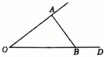

3. （3分）如图，$\angle AOB=40^{\circ}$，$\angle ABD=110^{\circ}$，则 $\angle OAB$ 的度数为（ ）

A. $75^{\circ}$

B. $70^{\circ}$

C. $65^{\circ}$

D. $60^{\circ}$

> [!question]- 点击查看答案与解析
> 【答案】B
> 
> 【考点】三角形的外角性质、三角形内角和 → [[【初中数学知识点体系-人教版】#13-3 三角形的内角与外角]]
> 
> 【解析】
> 由图可知点 $B$ 在射线 $OD$ 上，$\angle ABD$ 是 $\triangle AOB$ 在顶点 $B$ 处的外角。
> 由三角形外角性质，$\angle ABD=\angle AOB+\angle OAB$，
> 所以 $\angle OAB=\angle ABD-\angle AOB=110^{\circ}-40^{\circ}=70^{\circ}$。
> 也可这样算：$\angle ABO=180^{\circ}-\angle ABD=70^{\circ}$，再由内角和得 $\angle OAB=180^{\circ}-40^{\circ}-70^{\circ}=70^{\circ}$。
> 
> 【易错点】分不清 $\angle ABD$ 是外角还是内角：$B$、$D$ 在同一直线上，$\angle ABD$ 与 $\angle ABO$ 互为邻补角，不能把 $110^{\circ}$ 直接当作 $\triangle AOB$ 的内角使用。
