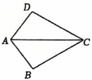

5. （3分）如图，已知 $AB=AD$，添加下列一个条件后，仍无法判定 $\triangle ABC\cong\triangle ADC$ 的是（ ）

A. $CB=CD$

B. $\angle BCA=\angle DCA$

C. $\angle BAC=\angle DAC$

D. $\angle B=\angle D=90^{\circ}$

> [!question]- 点击查看答案与解析
> 【答案】B
> 
> 【考点】三角形全等的判定（SSS、SAS、HL）与"边边角"的辨析 → [[【初中数学知识点体系-人教版】#14-2 三角形全等的判定]]
> 
> 【解析】
> 两个三角形已有两组边对应相等：$AB=AD$，$AC=AC$（公共边）。
> 选项A：$CB=CD$，三边分别相等，由 SSS 可判定全等；
> 选项B：$\angle BCA=\angle DCA$，这个角是 $AB$、$AD$ 的对角，而不是两边的夹角，属于"边边角"，不能判定全等，故无法判定；
> 选项C：$\angle BAC=\angle DAC$ 是 $AB$ 与 $AC$、$AD$ 与 $AC$ 的夹角，由 SAS 可判定全等；
> 选项D：$\angle B=\angle D=90^{\circ}$，$AC$ 为公共斜边，$AB=AD$ 为直角边，由 HL 可判定全等。
> 故选B。
> 
> 【易错点】看到"两边一角"就套 SAS，忽略角必须是两边的夹角；"边边角"（SSA）不能判定两个三角形全等，因为可能出现两种不同的三角形。本题中 $\angle BCA$、$\angle DCA$ 分别在 $AB$、$AD$ 的对面，正是边边角。
