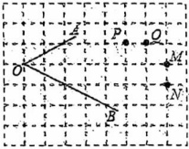

6. （3分）在正方形网格中，$\angle AOB$ 的位置如图所示，到 $\angle AOB$ 两边距离相等的点应是（ ）

A. $M$ 点

B. $N$ 点

C. $P$ 点

D. $Q$ 点

> [!question]- 点击查看答案与解析
> 【答案】A
> 
> 【考点】角平分线的性质与判定定理 → [[【初中数学知识点体系-人教版】#14-3 角的平分线]]
> 
> 【解析】
> 到角的两边距离相等的点，在这个角的平分线上，因此只需判断哪个点在 $\angle AOB$ 的平分线上。
> 由网格可数出：$OA$ 向上倾斜、$OB$ 向下倾斜，两条射线关于过点 $O$ 的水平直线对称，所以 $\angle AOB$ 的平分线就是过点 $O$ 且水平向右的直线。
> 观察各点位置：$M$ 点恰在这条水平平分线上，它到 $OA$、$OB$ 的距离相等；
> $P$ 点、$Q$ 点在这条平分线的上方，$N$ 点在平分线的下方，它们到两边的距离都不相等。
> 故选A。
> 
> 【易错点】凭"离顶点远近"判断。到角两边距离相等的关键在于"在角平分线上"，与到顶点 $O$ 的距离远近无关；$P$、$Q$ 离 $O$ 也较远，但不在平分线上。
