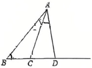

9. （3分）如图，在 $\triangle ABC$ 中，$\angle ABC=50^{\circ}$，$\angle BAC=20^{\circ}$，$D$ 为线段 $AB$ 的垂直平分线与直线 $BC$ 的交点，连接 $AD$，则 $\angle CAD=$（　　）

A. $40^{\circ}$

B. $30^{\circ}$

C. $20^{\circ}$

D. $10^{\circ}$

> [!question]- 点击查看答案与解析
> 【答案】B
> 
> 【考点】线段垂直平分线的性质、等腰三角形的性质、三角形内角和 → [[【初中数学知识点体系-人教版】#15-1 图形的轴对称]]、[[【初中数学知识点体系-人教版】#13-3 三角形的内角与外角]]
> 
> 【解析】
> 因为 $D$ 在线段 $AB$ 的垂直平分线上，所以 $DA=DB$，从而 $\angle DAB=\angle DBA$。
> 先确定 $D$ 的位置：若 $D$ 在线段 $BC$ 上，则 $\angle DBA=\angle CBA=50^{\circ}$，于是 $\angle DAB=50^{\circ}$，而 $D$ 在 $\angle BAC$ 内部应满足 $\angle DAB<\angle BAC=20^{\circ}$，矛盾。所以 $D$ 在 $BC$ 的延长线上（越过点 $C$）。
> 此时 $\angle DBA=\angle ABC=50^{\circ}$，故 $\angle DAB=50^{\circ}$，
> $\angle CAD=\angle DAB-\angle BAC=50^{\circ}-20^{\circ}=30^{\circ}$。
> 也可验证：$\angle C=180^{\circ}-50^{\circ}-20^{\circ}=110^{\circ}$，$C$ 在 $B$、$D$ 之间，$\angle ACD=180^{\circ}-110^{\circ}=70^{\circ}$，$\angle ADB=180^{\circ}-50^{\circ}-50^{\circ}=80^{\circ}$，所以 $\angle CAD=180^{\circ}-70^{\circ}-80^{\circ}=30^{\circ}$，结果一致。
> 
> 【易错点】不判断点 $D$ 的位置就乱用角度，容易得到 $\angle CAD=50^{\circ}-20^{\circ}$ 之外的其他错误结果（如误取 $\angle ABD=130^{\circ}$ 导致矛盾）；遇到"垂直平分线与直线相交"，要先用角度判断交点落在射线的哪一侧。
