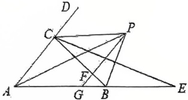

10. （3分）如图，在 $\triangle ABC$ 中，内角 $\angle BAC$ 与外角 $\angle EBC$ 的平分线相交于点 $P$，$BE=BC$，$D$ 在 $AC$ 延长线上，$PG//AD$ 交 $BC$ 于 $F$，交 $AB$ 于 $G$，连接 $CP$。下列结论：$①$ $\angle ACB=2\angle APB$；$②$ $S_{\triangle PAC}:S_{\triangle PAB}=PC:PB$；$③$ $BP$ 垂直平分 $CE$；$④$ $\angle PCF=\angle CPF$。其中正确的有（ ）

A. $①②④$

B. $①③④$

C. $②③④$

D. $①③$

> [!question]- 点击查看答案与解析
> 【答案】B
> 
> 【考点】角平分线的性质、三角形的外角、等腰三角形"三线合一"、平行线的性质 → [[【初中数学知识点体系-人教版】#14-3 角的平分线]]、[[【初中数学知识点体系-人教版】#13-3 三角形的内角与外角]]
> 
> 【解析】
> 记 $\angle BAC=\alpha$，$\angle ABC=\beta$，$\angle ACB=\gamma$，则 $\alpha+\beta+\gamma=180^{\circ}$。
> ① 因为 $AP$ 平分 $\angle BAC$，$BP$ 平分 $\angle EBC=180^{\circ}-\beta$，
> 所以 $\angle PAB=\frac{\alpha}{2}$，$\angle ABP=180^{\circ}-\frac{180^{\circ}-\beta}{2}=90^{\circ}+\frac{\beta}{2}$。
> 在 $\triangle ABP$ 中，$\angle APB=180^{\circ}-\frac{\alpha}{2}-\left(90^{\circ}+\frac{\beta}{2}\right)=90^{\circ}-\frac{\alpha+\beta}{2}=\frac{\gamma}{2}$，
> 即 $\angle ACB=2\angle APB$，①正确。
> ② 因为 $P$ 在 $\angle BAC$ 的平分线上，所以 $P$ 到 $AB$、$AC$ 的距离相等（设为 $h$）。
> $S_{\triangle PAC}:S_{\triangle PAB}=\left(\frac{1}{2}AC\cdot h\right):\left(\frac{1}{2}AB\cdot h\right)=AC:AB$，
> 一般情况下 $AC:AB\neq PC:PB$，②错误。
> ③ 因为 $BE=BC$，所以 $\triangle EBC$ 是以 $B$ 为顶点的等腰三角形；
> 又 $BP$ 平分 $\angle EBC$，由"三线合一"，$BP$ 垂直且平分 $CE$，③正确。
> ④ 因为 $P$ 到 $AB$、$AC$、$BC$ 三边所在直线的距离都相等，所以 $CP$ 平分 $\triangle ABC$ 在 $C$ 处的外角 $\angle DCB$，即 $\angle PCF=\angle PCD$。
> 又 $PG\parallel AD$，即 $PF\parallel CD$，所以 $\angle CPF=\angle PCD$（内错角）。
> 于是 $\angle PCF=\angle CPF$，④正确。
> 综上，正确的结论是 ①③④，故选B。
> 
> 【易错点】①中最容易误用"两外角平分线夹角 $=90^{\circ}-\frac{\angle A}{2}$"的结论（那是外角的情形），本题是"内角平分线与外角平分线"，夹角应为 $\frac{\angle C}{2}$；②中不能凭图形"看着相等"就判断面积比等于 $PC:PB$，要以 $P$ 到两边的距离相等为依据写出面积比。
