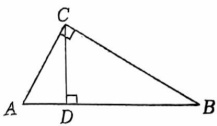

14. （3分）如图，在 $\triangle ABC$ 中，$\angle ACB=90^{\circ}$，$\angle B=30^{\circ}$，$CD$ 是高。若 $AD=2$，则 $BD=$ ___ .

> [!question]- 点击查看答案与解析
> 【答案】$6$
> 
> 【考点】直角三角形两锐角互余、含 $30^{\circ}$ 角的直角三角形的性质 → [[【初中数学知识点体系-人教版】#13-3 三角形的内角与外角]]、[[【初中数学知识点体系-人教版】#15-3 等腰三角形]]
> 
> 【解析】
> 因为 $\angle ACB=90^{\circ}$，$\angle B=30^{\circ}$，所以 $\angle A=60^{\circ}$。
> 因为 $CD\perp AB$，在 Rt$\triangle ACD$ 中，$\angle ADC=90^{\circ}$，$\angle A=60^{\circ}$，所以 $\angle ACD=30^{\circ}$。
> 在 Rt$\triangle ACD$ 中，$30^{\circ}$ 角所对的直角边是 $AD$，所以 $AC=2AD=2\times 2=4$。
> 在 Rt$\triangle ABC$ 中，$30^{\circ}$ 角（$\angle B$）所对的直角边是 $AC$，所以 $AB=2AC=8$。
> 因此 $BD=AB-AD=8-2=6$。
> 
> 【易错点】两次用"$30^{\circ}$ 角所对的直角边等于斜边的一半"时，找错对应的直角边：在 $\triangle ACD$ 中 $30^{\circ}$ 角是 $\angle ACD$，它对的边是 $AD$；在 $\triangle ABC$ 中 $30^{\circ}$ 角是 $\angle B$，它对的边是 $AC$。
