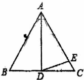

15. （3分）如图，$AD$ 是等边三角形 $ABC$ 的中线，$AE=AD$，则 $\angle EDC=$ ___ .

> [!question]- 点击查看答案与解析
> 【答案】$15^{\circ}$
> 
> 【考点】等边三角形的性质、等腰三角形的性质、三线合一 → [[【初中数学知识点体系-人教版】#15-3 等腰三角形]]
> 
> 【解析】
> 因为 $\triangle ABC$ 是等边三角形，$AD$ 是中线，由"三线合一"得 $AD\perp BC$，且 $AD$ 平分 $\angle BAC$。
> 所以 $\angle ADC=90^{\circ}$，$\angle DAE=\angle DAC=\frac{1}{2}\times 60^{\circ}=30^{\circ}$。
> 又 $AE=AD$，所以 $\triangle ADE$ 是等腰三角形，$\angle ADE=\angle AED=\frac{180^{\circ}-30^{\circ}}{2}=75^{\circ}$。
> 因为点 $E$ 在 $AC$ 上，$DE$ 在 $\angle ADC$ 的内部，
> 所以 $\angle EDC=\angle ADC-\angle ADE=90^{\circ}-75^{\circ}=15^{\circ}$。
> 
> 【易错点】忘记"三线合一"而不知道 $AD\perp BC$；或把 $\angle ADE$ 当成顶角用 $\frac{180^{\circ}-\angle DAE}{2}$ 之外的错误算法，注意等腰三角形中相等的两边是 $AD$、$AE$，所以相等的角是 $\angle ADE$ 与 $\angle AED$，顶角才是 $\angle DAE$。
