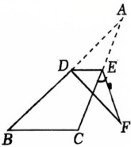

16. （3分）如图，将三角形 $ABC$ 沿平行于 $BC$ 的直线折叠，折痕为 $DE$，点 $A$ 落在点 $F$ 处，若 $\angle FEC=40^{\circ}$，则 $\angle C$ 的度数为 ___ .

> [!question]- 点击查看答案与解析
> 【答案】$70^{\circ}$
> 
> 【考点】轴对称（折叠）的性质、平行线的性质 → [[【初中数学知识点体系-人教版】#15-1 图形的轴对称]]、[[【初中数学知识点体系-人教版】#7-2 平行线]]
> 
> 【解析】
> 折叠是轴对称变换，点 $A$ 与点 $F$ 关于折痕 $DE$ 对称，所以 $\angle AED=\angle DEF$。
> 点 $A$、$E$、$C$ 在同一直线上，$\angle AEC=180^{\circ}$，且 $\angle AED+\angle DEF+\angle FEC=180^{\circ}$，
> 所以 $2\angle AED=180^{\circ}-40^{\circ}=140^{\circ}$，$\angle AED=70^{\circ}$。
> 又 $DE\parallel BC$，$AC$ 为截线，$\angle AED$ 与 $\angle C$ 是同位角，
> 所以 $\angle C=\angle AED=70^{\circ}$。
> 
> 【易错点】把 $\angle FEC=40^{\circ}$ 直接当作 $\angle AED$ 或 $\angle DEF$ 使用。折叠后的关键关系是"折痕平分 $\angle AEF$"，即 $\angle AED=\angle DEF$，应先由平角求出 $\angle AED$，再用平行线把角"搬"到 $\angle C$。
