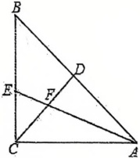

17. （3分）如图，$\triangle ABC$ 中，$\angle ACB=90^{\circ}$，$CD\perp AB$ 于点 $D$，$AE$ 是 $\angle BAC$ 的平分线，点 $E$ 到 $AB$ 的距离等于 $3$ cm，则 $CF=$ ___ cm。

> [!question]- 点击查看答案与解析
> 【答案】$3$
> 
> 【考点】角平分线的性质、直角三角形的两锐角互余、等腰三角形的判定（等角对等边） → [[【初中数学知识点体系-人教版】#14-3 角的平分线]]、[[【初中数学知识点体系-人教版】#15-3 等腰三角形]]
> 
> 【解析】
> 由图形知 $E$ 在 $BC$ 上，$F$ 是 $AE$ 与 $CD$ 的交点。
> 因为 $\angle ACB=90^{\circ}$，所以 $EC\perp AC$，即点 $E$ 到 $AC$ 的距离就是 $EC$。
> 又 $AE$ 平分 $\angle BAC$，由角平分线的性质，点 $E$ 到 $AB$ 的距离等于它到 $AC$ 的距离，
> 所以 $EC=3$ cm。
> 设 $\angle CAE=\angle BAE=\alpha$。
> 在 Rt$\triangle ACE$ 中，$\angle CEF=90^{\circ}-\alpha$。
> 在 $\triangle ADF$ 中，$CD\perp AB$，所以 $\angle ADF=90^{\circ}$，$\angle AFD=90^{\circ}-\alpha$。
> 因为 $\angle CFE$ 与 $\angle AFD$ 是对顶角，所以 $\angle CFE=90^{\circ}-\alpha$。
> 于是 $\angle CEF=\angle CFE$，由"等角对等边"得 $CF=CE=3$ cm。
> 
> 【易错点】看到"点 $E$ 到 $AB$ 的距离"却想不到用角平分线性质把它转化为 $EC$（因为 $EC\perp AC$ 是点 $E$ 到 $AC$ 的距离）；另外求 $CF$ 时忘记用对顶角 $\angle CFE=\angle AFD$ 来证等腰三角形。
