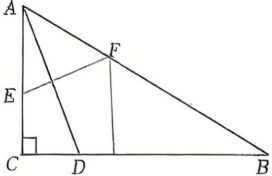
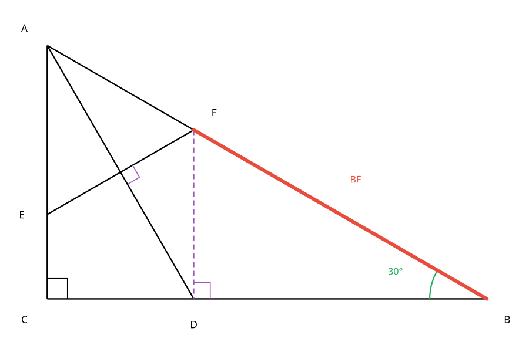

18. （3分）如图，Rt $\triangle ABC$ 中，$\angle ACB=90^{\circ}$，$\angle B=30^{\circ}$，$AC=2$。$D$ 为 $BC$ 上一动点，连接 $AD$，$AD$ 的垂直平分线分别交 $AC$，$AB$ 于点 $E$，$F$，则线段 $BF$ 长的最大值是 ___ .

> [!question]- 点击查看答案与解析
> 【答案】$\frac{8}{3}$
> 
> 【考点】线段垂直平分线的性质、垂线段最短、含 $30^{\circ}$ 角的直角三角形的性质 → [[【初中数学知识点体系-人教版】#15-1 图形的轴对称]]、[[【初中数学知识点体系-人教版】#15-3 等腰三角形]]
> 
> 【解析】
> 在 Rt$\triangle ABC$ 中，$\angle B=30^{\circ}$，$AC=2$，所以 $AB=2AC=4$。
> 因为 $F$ 在 $AD$ 的垂直平分线上，所以 $FA=FD$。
> 设 $BF=x$，则 $FA=FD=4-x$。
> 点 $D$ 在直线 $BC$ 上，而点 $F$ 到直线 $BC$ 的距离为 $\frac{x}{2}$（过 $F$ 作 $BC$ 的垂线，在含 $30^{\circ}$ 角的直角三角形中，$30^{\circ}$ 所对的直角边等于斜边 $BF$ 的一半）。
> 由"垂线段最短"得 $FD\geqslant\frac{x}{2}$，即 $4-x\geqslant\frac{x}{2}$，
> 解得 $x\leqslant\frac{8}{3}$。
> 当 $FD\perp BC$（垂足恰为 $D$）时可取等号，此时 $Rt\triangle FDB$ 中 $\angle B=30^{\circ}$，$FD=\frac{1}{2}BF$，即 $4-BF=\frac{BF}{2}$，$BF=\frac{8}{3}$。
> 取等时验证构型合法：此时 $CD=BC-BD=2\sqrt{3}-\frac{4\sqrt{3}}{3}=\frac{2\sqrt{3}}{3}$，垂足 $D$ 落在线段 $BC$ 上；再算得 $AD$ 的垂直平分线与 $AC$ 的交点 $E$ 满足 $CE=\frac{2}{3}<2$，即 $E$ 在线段 $AC$ 上、$F$ 在线段 $AB$ 上，与题设"分别交 $AC$，$AB$ 于 $E$，$F$"完全吻合。
> 所以 $BF$ 长的最大值是 $\frac{8}{3}$。
> 
> 验证（数值自校验 30 项全部通过）：建系方位同原卷（$C$ 左下直角、$A$ 在 $C$ 正上方、$B$ 在 $C$ 正右方），极值构型精确坐标 $C(0,0)$、$A(0,2)$、$B(2\sqrt3,0)$、$D\left(\tfrac{2\sqrt3}{3},0\right)$、$E\left(0,\tfrac23\right)$、$F\left(\tfrac{2\sqrt3}{3},\tfrac43\right)$、$AD$ 中点 $M\left(\tfrac{\sqrt3}{3},1\right)$。逐项成立：$\angle ACB=90^{\circ}$、$\angle B=30^{\circ}$、$AC=2$、$AB=4$、$BC=2\sqrt3$；$D$、$E$、$F$ 分别在线段 $BC$、$AC$、$AB$ 上；$FA=FD$、$EA=ED$、$EF\perp AD$ 且 $EF$ 过 $AD$ 中点 $M$（$EF$ 即 $AD$ 的垂直平分线）；$FD\perp BC$、$BF=\tfrac83$、$FA=4-BF$、$FD=\tfrac12BF$、$FD$ 等于 $F$ 到 $BC$ 的垂线段长。扫描验证：$CD=d$ 在可行域 $d\in[0,2]$（保证 $E$ 落在线段 $AC$ 上）内取 401 点，由 $FA=FD$ 解得 $BF(d)=\dfrac{4(-d^2+4\sqrt3 d+4)}{4\sqrt3 d+8}$，恒有 $BF\leqslant\tfrac83$，最大值点 $d\approx\tfrac{2\sqrt3}{3}$，且全程 $FA=FD$、$E\in AC$、$F\in AB$ 成立；放宽到整条 $BC$（$d\in[0,2\sqrt3]$）扫描，上界仍为 $\tfrac83$。方位检查 6 项："方位: $C$ 左下直角、$A$ 在 $C$ 正上方、$B$ 在 $C$ 正右方"、"方位: $D$ 在 $BC$ 上且靠近 $C$"、"方位: $E$ 在 $AC$ 上、位于 $A$ 下方"、"方位: $F$ 在 $AB$ 上、$D$ 正上方"、"方位: 线段 $EF$ 与 $AD$ 在图形内部相交"、"方位: 直角标记在 $C$（左下）"。原解析结论正确（仅距离表述中的 $\sin$ 记号属九年级内容，已改为课标内等价的"含 $30^{\circ}$ 角直角三角形性质"表述，推导与结论不变）；配图按极值构型（$FD\perp BC$）绘制：$BF$ 红色加粗为所求线段，$FD$ 紫色虚线为取等辅助线，$C$ 处黑色直角标记为题设 $\angle ACB=90^{\circ}$，$D$、$M$ 处紫色直角标记为 $FD\perp BC$ 与 $EF\perp AD$，$B$ 处绿色角弧为 $30^{\circ}$。
> 
> 
> 
> 【易错点】只想"端点 $D$ 取 $B$ 或 $C$ 时最大"，不做分析就猜答案。实际上当 $D$ 从 $C$ 移到 $B$ 时 $BF$ 先增后减（数值扫描表明 $D$ 在 $C$ 或 $B$ 端点时 $BF$ 都只有 $2$，最大值 $\frac{8}{3}$ 在中间取得），要用"垂线段最短"建立不等式求上界；另外取等时必须回验垂足 $D$ 与交点 $E$、$F$ 都落在题设线段上，否则上界不可达。
