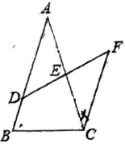

21. （5分）如图，在 $\triangle ABC$ 中，$D$ 是边 $AB$ 上一点，$E$ 是边 $AC$ 的中点，作 $CF\parallel AB$ 交 $DE$ 的延长线于点 $F$。

（1）证明：$\triangle ADE\cong\triangle CFE$；

（2）若 $\angle B=\angle ACB$，$CE=5$，$CF=7$，求 $DB$。

> [!question]- 点击查看答案与解析
> 【答案】（1）证明见解析；（2）$DB=3$
> 
> 【考点】三角形全等的判定（ASA）、全等三角形的性质、等腰三角形的判定 → [[【初中数学知识点体系-人教版】#14-2 三角形全等的判定]]、[[【初中数学知识点体系-人教版】#15-3 等腰三角形]]
> 
> 【解析】
> （1）证明：
> $\because E$ 是 $AC$ 的中点，$\therefore AE=CE$。
> $\because CF\parallel AB$，$\therefore \angle DAE=\angle FCE$（两直线平行，内错角相等）。
> 又 $\angle AED=\angle CEF$（对顶角相等），
> 在 $\triangle ADE$ 和 $\triangle CFE$ 中，
> $\begin{cases}\angle DAE=\angle FCE\\ AE=CE\\ \angle AED=\angle CEF\end{cases}$
> $\therefore \triangle ADE\cong\triangle CFE$（ASA）。
> （2）由（1）得 $\triangle ADE\cong\triangle CFE$，所以 $AD=CF=7$。
> $\because \angle B=\angle ACB$，$\therefore AB=AC$（等角对等边）。
> $\because E$ 是 $AC$ 的中点，$CE=5$，$\therefore AC=2CE=10$，$\therefore AB=10$。
> $\therefore DB=AB-AD=10-7=3$。
> 
> 【易错点】（1）中把"平行"给出的内错角找错（$CF\parallel AB$ 与截线 $AC$ 形成的内错角是 $\angle DAE$ 与 $\angle FCE$，不是 $\angle ADE$ 与 $\angle F$）；（2）中求出 $AD=7$ 后忘记先由 $\angle B=\angle ACB$ 得 $AB=AC=10$，直接拿 $CE=5$ 当 $AB$ 使用。
