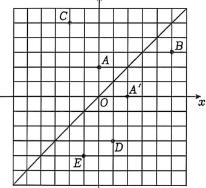

22. （5分）如图，在平面直角坐标系中，直线 $l$ 是第一、三象限的角平分线。

（1）由图观察易知 $A(0,2)$ 关于直线 $l$ 的对称点 $A'$ 的坐标为 $(2,0)$，请直接写出 $B(5,3)$、$C(-2,5)$ 关于直线 $l$ 的对称点 $B'$、$C'$ 的坐标：$B'=$ ___ ，$C'=$ ___ .

（2）结合图形观察以上三组点的坐标，你会发现：坐标平面内任一点 $P(a,b)$ 关于第一、三象限的角平分线 $l$ 的对称点 $P'$ 的坐标为 ___ .

（3）已知两点 $D(1,-3)$、$E(-1,-4)$，试在直线 $l$ 上确定一点 $Q$，使点 $Q$ 到 $D$、$E$ 两点的距离之和最小。（不写作法，保留作图痕迹）

> [!question]- 点击查看答案与解析
> 【答案】（1）$B'(3,5)$，$C'(5,-2)$；（2）$(b,a)$；（3）作图见解析，$Q\left(-\frac{13}{7},-\frac{13}{7}\right)$
> 
> 【考点】用坐标表示轴对称、关于直线 $y=x$ 的对称点、最短路径问题（将军饮马） → [[【初中数学知识点体系-人教版】#15-2 画轴对称的图形]]
> 
> 【解析】
> （1）第一、三象限的角平分线 $l$ 的解析式为 $y=x$，点 $(x,y)$ 关于 $y=x$ 的对称点为 $(y,x)$。
> 所以 $B(5,3)$ 的对称点 $B'(3,5)$，$C(-2,5)$ 的对称点 $C'(5,-2)$。
> （2）由 $A(0,2)\to A'(2,0)$、$B(5,3)\to B'(3,5)$、$C(-2,5)\to C'(5,-2)$ 可得：任一点 $P(a,b)$ 关于 $l$ 的对称点为 $P'(b,a)$（横、纵坐标互换）。
> （3）作点 $D(1,-3)$ 关于直线 $l$ 的对称点 $D'(-3,1)$，连接 $D'E$ 交直线 $l$ 于点 $Q$，则点 $Q$ 即为所求。
> 理由：$QD=QD'$，所以 $QD+QE=QD'+QE\geqslant D'E$，当 $Q$ 在线段 $D'E$ 上时取等号。
> 设直线 $D'E$ 的解析式为 $y=kx+m$，代入 $D'(-3,1)$、$E(-1,-4)$ 得 $k=-\frac{5}{2}$，$m=-\frac{13}{2}$，即 $y=-\frac{5}{2}x-\frac{13}{2}$。
> 令 $y=x$，得 $x=-\frac{13}{7}$，所以 $Q\left(-\frac{13}{7},-\frac{13}{7}\right)$。
> 
> 验证（数值自校验全部通过）：$D'(-3,1)$ 与 $D(1,-3)$ 关于 $y=x$ 对称；直线 $D'E$ 的解析式 $y=-\frac{5}{2}x-\frac{13}{2}$ 同时过 $D'$、$E$ 两点；其与 $y=x$ 的交点确为 $\left(-\frac{13}{7},-\frac{13}{7}\right)$，且该点落在线段 $D'E$ 上；沿直线 $l$ 网格扫描确认其余点处 $QD+QE$ 均更大。**修正说明**：原解析末句以两点间距离公式（隐含勾股定理，属八下内容）额外算出最小值 $\sqrt{29}$——本题（3）只要求确定点 $Q$ 的位置，该计算既多余又超纲，已删除。
> 
> 【易错点】关于 $y=x$ 的对称点不是"两个坐标都变号"（那是关于原点对称），而是横、纵坐标互换；第（3）问要作对称点转化为"两点之间线段最短"，若直接连接 $D$、$E$ 与直线 $l$ 相交，得到的是使 $|QD-QE|$ 最大的点，不是距离和最小的点。
