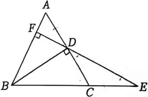

23. （5分）如图，在 $\triangle ABC$ 中，$BD$ 是高，点 $D$ 是 $AC$ 边的中点，点 $E$ 在 $BC$ 边的延长线上，$ED$ 的延长线交 $AB$ 于点 $F$，且 $EF\perp AB$，若 $\angle E=30^{\circ}$。

（1）求证：$\triangle ABC$ 是等边三角形；

（2）请判断线段 $AD$ 与 $CE$ 的大小关系，并说明理由。

> [!question]- 点击查看答案与解析
> 【答案】（1）证明见解析；（2）$AD=CE$，理由见解析
> 
> 【考点】线段垂直平分线的性质、等腰三角形与等边三角形的判定、等角对等边 → [[【初中数学知识点体系-人教版】#15-3 等腰三角形]]、[[【初中数学知识点体系-人教版】#13-2 与三角形有关的线段]]
> 
> 【解析】
> （1）证明：
> $\because BD$ 是 $\triangle ABC$ 的高，$\therefore BD\perp AC$。
> 又 $D$ 是 $AC$ 的中点，$\therefore BD$ 是 $AC$ 的垂直平分线，
> $\therefore BA=BC$（线段垂直平分线上的点到线段两端点的距离相等）。
> $\because EF\perp AB$，$\therefore \angle BFE=90^{\circ}$。
> 在 Rt$\triangle BEF$ 中，$\angle E=30^{\circ}$，$\therefore \angle EBF=60^{\circ}$，即 $\angle ABC=60^{\circ}$。
> $\because BA=BC$ 且 $\angle ABC=60^{\circ}$，
> $\therefore \triangle ABC$ 是等边三角形（有一个角是 $60^{\circ}$ 的等腰三角形是等边三角形）。
> （2）$AD=CE$。理由如下：
> 由（1）知 $\triangle ABC$ 是等边三角形，$\therefore AC=BC$，$\angle ACB=60^{\circ}$。
> $\because E$ 在 $BC$ 的延长线上，$\therefore \angle DCE=180^{\circ}-\angle ACB=120^{\circ}$。
> 在 $\triangle DCE$ 中，$\angle DCE=120^{\circ}$，$\angle CED=30^{\circ}$，
> $\therefore \angle CDE=180^{\circ}-120^{\circ}-30^{\circ}=30^{\circ}$，
> $\therefore \angle CDE=\angle CED$，$\therefore CE=CD$（等角对等边）。
> $\because D$ 是 $AC$ 的中点，$\therefore AD=CD$，
> $\therefore AD=CE$。
> 
> 验证（数值自校验全部通过）：坐标法复核（1）$BA=BC$、$\angle ABC=60^{\circ}$；（2）$\angle DCE=120^{\circ}$、$\angle CDE=\angle CED=30^{\circ}$、$CE=CD=AD$ 均严格成立。**修正说明**：原解析（2）中混入一段多余且角度标号写反的推导（"$\angle BEF=60^{\circ}$、$\angle FBE=30^{\circ}$、$BF=\frac{1}{2}BE$"——实际 $\angle BEF$ 即题设 $\angle E=30^{\circ}$，$\angle FBE=60^{\circ}$，与（1）中 $\angle EBF=60^{\circ}$ 自相矛盾），该段在 $AD=CE$ 的推导中未被使用，已删除。
> 
> 【易错点】（1）中忽略"高 + 中点"可推出垂直平分线，从而漏掉 $BA=BC$ 这一关键条件；（2）中不注意 $E$ 在 $BC$ 的延长线上，把 $\angle DCE$ 当成 $60^{\circ}$，导致后续角度全错。
