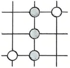
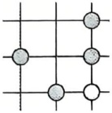
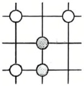
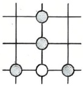

1. （3分）围棋作为一种古老的数学游戏，其棋盘格状结构及行棋规则蕴含着古人对空间、逻辑与对称的深刻理解。下列由黑白棋子摆成的图案中，是轴对称图形的是（）

A.

B.

C.

D.

> [!question]- 点击查看答案与解析
> 【答案】D
> 
> 【考点】轴对称图形的概念与识别 → [[【初中数学知识点体系-人教版】#15-1 图形的轴对称]]
> 
> 【解析】
> 轴对称图形必须存在一条直线，使图形沿这条直线折叠后，直线两旁的部分能够完全重合。由于黑、白棋子颜色不同，折叠后还必须做到"位置相同、颜色相同"。
> 选项A：上排右侧的白子找不到对应位置的白子，棋子分布左右、上下都不对称，不是轴对称图形；
> 选项B：棋子的分布呈斜向零散状态，无论沿竖直、水平还是斜向直线折叠，都无法使黑白棋子一一重合，不是轴对称图形；
> 选项C：上排两枚白子关于中间竖直线对称，但下方棋子只分布在左侧和中间，右侧没有对应棋子，折叠后不能完全重合，不是轴对称图形；
> 选项D：以中间那列棋子所在的竖直线为对称轴，上、中两枚黑子在对称轴上，底排三枚棋子"黑—白—黑"左右对称，沿这条竖直线折叠后两旁的黑白棋子完全重合，是轴对称图形。
> 
> 【易错点】判断轴对称图形时只看棋子"大致分布"而不看颜色，容易误选；必须同时满足位置对称与颜色对称，且对称轴是真实存在的一条直线。
