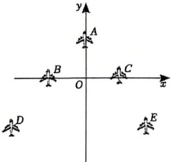

3. （3分）如图，战机在空中展示的图形是轴对称队形，以飞机 $B$，$C$ 所在直线为 $x$ 轴、队形的对称轴为 $y$ 轴，建立平面直角坐标系．若飞机 $E$ 的坐标为 $(50,m)$，则飞机 $D$ 的坐标为（）

A. $(-50,m)$

B. $(50,-m)$

C. $(-50,-m)$

D. $(m,-50)$

> [!question]- 点击查看答案与解析
> 【答案】A
> 
> 【考点】关于坐标轴对称的点的坐标特征 → [[【初中数学知识点体系-人教版】#15-2 画轴对称的图形]]
> 
> 【解析】
> 队形的对称轴为 $y$ 轴，即点 $D$ 与点 $E$ 关于 $y$ 轴对称。
> 关于 $y$ 轴对称的两个点，纵坐标相同、横坐标互为相反数，所以点 $E(50,m)$ 的对称点为 $D(-50,m)$。
> 选项A：$(-50,m)$，符合"横坐标变号、纵坐标不变"，正确；
> 选项B：$(50,-m)$ 是关于 $x$ 轴对称的结果，错误；
> 选项C：$(-50,-m)$ 是关于原点对称的结果，错误；
> 选项D：$(m,-50)$ 是横、纵坐标互换的结果，错误。
> 
> 【易错点】混淆关于 $x$ 轴、$y$ 轴、原点对称的坐标变化规律：关于 $x$ 轴对称纵坐标变号，关于 $y$ 轴对称横坐标变号，关于原点对称横、纵坐标都变号。
