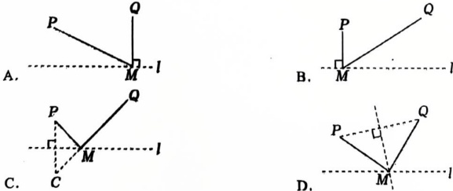

5. （3分）某景区有一条笔直的观光车道和两个著名景点，景区计划在观光车道旁修建一个休息站，并铺设步道分别连接两个景点．某同学用直线（虚线）$l$ 表示车道，$P$，$Q$ 两点表示景点，线段（实线）表示步道，画出了如下四个示意图，则所需步道最短的是（ ）

> [!question]- 点击查看答案与解析
> 【答案】C
> 
> 【考点】利用轴对称求最短路径（"将军饮马"模型）、两点之间线段最短 → [[【初中数学知识点体系-人教版】#15-1 图形的轴对称]]
> 
> 【解析】
> 休息站 $M$ 在车道 $l$ 上，所需步道总长为 $MP+MQ$，问题就是求 $l$ 上一点 $M$，使 $MP+MQ$ 最小。
> 选项A：$M$ 为垂足，$MQ\perp l$，此时 $MP+MQ$ 并不最小，且只照顾了其中一个景点；
> 选项B：$PM\perp l$，同样只是把 $P$ 到 $l$ 的距离直接连出，$MP+MQ$ 不是最短；
> 选项C：作点 $P$ 关于直线 $l$ 的对称点 $C$（图中虚线 $PC\perp l$ 且 $l$ 平分 $PC$），连接 $CQ$ 交 $l$ 于点 $M$。由对称性 $MP=MC$，于是 $MP+MQ=MC+MQ=CQ$，而两点之间线段最短，所以此时的步道最短；
> 选项D：虽在 $l$ 上取点 $M$ 连接 $P$、$Q$，但没有作对称点转化，折线 $PM+MQ$ 大于 $CQ$，不是最短。
> 
> 【易错点】只比较某一条垂线段的长短，而忽略"两条线段之和"；此类问题必须作对称点，把折线转化为两点间的线段。
