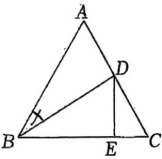

6. （3分）如图，在等边 $\triangle ABC$ 中，$BD$ 平分 $\angle ABC$ 交 $AC$ 于点 $D$，过点 $D$ 作 $DE\perp BC$ 于点 $E$，且 $CE=2$，则 $AB$ 的长为（）

A. 4

B. 5

C. 6

D. 8

> [!question]- 点击查看答案与解析
> 【答案】D
> 
> 【考点】等边三角形的性质、等腰三角形"三线合一"、含 $30^{\circ}$ 角的直角三角形 → [[【初中数学知识点体系-人教版】#15-3 等腰三角形]]
> 
> 【解析】
> 因为 $\triangle ABC$ 是等边三角形，所以 $\angle C=60^{\circ}$，$AC=AB$。
> 又 $BD$ 平分 $\angle ABC$，由等腰三角形"三线合一"，$BD$ 也是 $AC$ 边上的中线，所以 $AD=DC=\frac{1}{2}AC$。
> 在 $Rt\triangle DEC$ 中，$\angle DEC=90^{\circ}$，$\angle C=60^{\circ}$，所以 $\angle CDE=30^{\circ}$。
> 于是 $DC=2CE=2\times2=4$（$30^{\circ}$ 角所对的直角边等于斜边的一半，这里 $CE$ 是 $30^{\circ}$ 角所对的边）。
> 所以 $AC=2DC=8$，从而 $AB=AC=8$。
> 选项A、B、C 均不符合计算结果，故选 D。
> 
> 【易错点】把 $CE$ 当成斜边或把 $DC=CE$ 直接用；在 $Rt\triangle DEC$ 中斜边是 $DC$，$CE$ 是 $\angle CDE=30^{\circ}$ 所对的直角边，应满足 $CE=\frac{1}{2}DC$。
