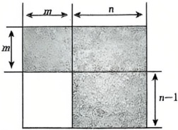

7. （3分）下面四个整式中，表示图中阴影部分面积的是（ ）

A. $m(m+n)+m(n-1)$

B. $n(m+n-1)+m^2$

C. $(m+n)(m+n-1)-n(n-1)$

D. $m^2+(2n-1)m$

> [!question]- 点击查看答案与解析
> 【答案】B
> 
> 【考点】列代数式表示图形面积、整式的乘法 → [[【初中数学知识点体系-人教版】#16-2 整式的乘法]]
> 
> 【解析】
> 观察图形，整个图形是一个宽为 $m+n$ 的长方形，阴影部分由三块组成：
> ① 左上角边长为 $m$ 的正方形，面积为 $m^2$；
> ② 右上角宽为 $n$、高为 $m$ 的长方形，面积为 $mn$；
> ③ 右下角宽为 $n$、高为 $n-1$ 的长方形，面积为 $n(n-1)$。
> 所以阴影部分面积为 $m^2+mn+n(n-1)$。
> 选项A：$m(m+n)+m(n-1)=m^2+mn+mn-m=m^2+2mn-m$，多算了一块 $m(n-1)$，错误；
> 选项B：$n(m+n-1)+m^2=mn+n^2-n+m^2=m^2+mn+n(n-1)$，与阴影面积相等，正确；
> 选项C：$(m+n)(m+n-1)-n(n-1)$ 表示的是大长方形减去右下角阴影，得到的是空白部分与左上、右上两块的和，不是阴影面积，错误；
> 选项D：$m^2+(2n-1)m=m^2+2mn-m$，与选项A相同，多算了 $m(n-1)$，错误。
> 
> 【易错点】分块时把空白长方形的边长弄错（空白部分是宽 $m$、高 $n-1$）；列式后应展开化简再与选项比较，不能只看形式。
