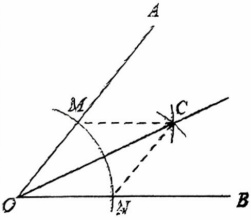

8. （3分）下面是“作 $\angle AOB$ 的角平分线”的尺规作图方法：

（1）以点 $O$ 为圆心，适当长为半径画弧，交 $OA$ 于点 $M$，交 $OB$ 于点 $N$.

（2）分别以点 $M$，$N$ 为圆心，大于 $\frac{1}{2}MN$ 长为半径画弧，两弧在 $\angle AOB$ 内部交于点 $C$。

（3）画射线 $OC$，射线 $OC$ 即为所求.

上述方法是通过判定 $\triangle OMC\cong\triangle ONC$ 得到 $\angle MOC=\angle NOC$ 的，其中判定 $\triangle OMC\cong\triangle ONC$ 的依据是（ ）

A. 两边及其夹角分别相等的两个三角形全等

B. 三边分别相等的两个三角形全等

C. 两角及其夹边分别相等的两个三角形全等

D. 两角分别相等且其中一组等角的对边相等的两个三角形全等

> [!question]- 点击查看答案与解析
> 【答案】B
> 
> 【考点】用"边边边"判定三角形全等、角平分线的尺规作图 → [[【初中数学知识点体系-人教版】#14-2 三角形全等的判定]]
> 
> 【解析】
> 由作图过程可知：
> $OM=ON$（第一次画弧时半径相同）；
> $CM=CN$（第二次画弧时两弧半径相同）；
> $OC=OC$（公共边）。
> 三组边分别相等，所以 $\triangle OMC\cong\triangle ONC$，依据是"边边边"（SSS），从而 $\angle MOC=\angle NOC$。
> 选项A：两边及其夹角（SAS），图中没有给出夹角相等的条件，错误；
> 选项B：三边分别相等（SSS），符合上述分析，正确；
> 选项C：两角及其夹边（ASA），没有两角相等的条件，错误；
> 选项D：两角及其中一组等角的对边（AAS），同样缺少角相等的条件，错误。
> 
> 【易错点】只看到"$OC$ 是公共边、$OM=ON$"就误选 SAS，忽略 $CM=CN$ 这一关键条件；尺规作角平分线的本质是"圆的半径相等"，应找全三组对应边。
