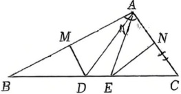

9. （3分）如图，在 $\triangle ABC$ 中，$DM$，$EN$ 分别垂直平分 $AB$ 和 $AC$，垂足为 $M$，$N$，且分别交 $BC$ 于点 $D$，$E$、若 $\angle BAC=100^{\circ}$，则 $\angle DAE$ 的度数为（ ）

A. $20^{\circ}$

B. $30^{\circ}$

C. $45^{\circ}$

D. $60^{\circ}$

> [!question]- 点击查看答案与解析
> 【答案】A
> 
> 【考点】线段垂直平分线的性质、等腰三角形的"等边对等角"、三角形内角和 → [[【初中数学知识点体系-人教版】#15-1 图形的轴对称]]
> 
> 【解析】
> 因为 $DM$ 是 $AB$ 的垂直平分线，所以 $DA=DB$，由"等边对等角"得 $\angle DAB=\angle B$；
> 因为 $EN$ 是 $AC$ 的垂直平分线，所以 $EA=EC$，得 $\angle EAC=\angle C$。
> 在 $\triangle ABC$ 中，$\angle B+\angle C=180^{\circ}-\angle BAC=180^{\circ}-100^{\circ}=80^{\circ}$。
> 由图形可知 $\angle DAE=\angle BAC-\angle DAB-\angle EAC$，
> 所以 $\angle DAE=100^{\circ}-(\angle B+\angle C)=100^{\circ}-80^{\circ}=20^{\circ}$。
> 选项A：$20^{\circ}$，正确；选项B、C、D 均不符合。
> 
> 【易错点】未使用垂直平分线把 $\angle DAB$、$\angle EAC$ 分别转化为 $\angle B$、$\angle C$，导致无法把已知角联系起来；另外要注意 $D$、$E$ 在 $BC$ 上，$\angle DAE$ 是 $\angle BAC$ 去掉两侧两角后的剩余部分。
