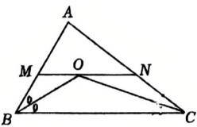

14. （3分）如图，在 $\triangle ABC$ 中，$AB=6$，$AC=8$，$\angle ABC$ 和 $\angle ACB$ 的平分线交于 $O$ 点，过点 $O$ 作 $BC$ 的平行线交 $AB$ 于 $M$ 点，交 $AC$ 于 $N$ 点，则 $\triangle AMN$ 的周长为 ___ .

> [!question]- 点击查看答案与解析
> 【答案】14
> 
> 【考点】角平分线加平行线构造等腰三角形、等腰三角形的判定 → [[【初中数学知识点体系-人教版】#15-3 等腰三角形]]
> 
> 【解析】
> 因为 $MN\parallel BC$，所以 $\angle MOB=\angle OBC$（两直线平行，内错角相等）。
> 又 $BO$ 平分 $\angle ABC$，所以 $\angle MBO=\angle OBC=\angle MOB$，
> 由"等角对等边"得 $MB=MO$。
> 同理，$MN\parallel BC$ 得 $\angle NOC=\angle OCB$，而 $CO$ 平分 $\angle ACB$，
> 所以 $\angle NCO=\angle OCB=\angle NOC$，得 $NC=NO$。
> 于是 $\triangle AMN$ 的周长
> $=AM+MN+AN=AM+(MO+ON)+AN$
> $=(AM+MB)+(AN+NC)=AB+AC=6+8=14$。
> 
> 【易错点】看不出"角平分线 $+$ 平行线"可得到等腰三角形，从而无法把 $MO$、$NO$ 分别转移到 $MB$、$NC$；另外容易把周长误算为 $AB+AC+MN$。
