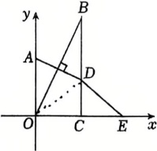

15. （3分）如图，在平面直角坐标系 $xOy$ 中，点 $A$ 在 $y$ 轴上，$BC\perp x$ 轴于点 $C$，点 $A$ 关于直线 $OB$ 的对称点 $D$ 恰好落在线段 $BC$ 上，点 $E$ 与点 $O$ 关于直线 $BC$ 对称，$\angle OBC=22^{\circ}$，则 $\angle OED$ 的度数为 ___ .

> [!question]- 点击查看答案与解析
> 【答案】$46^{\circ}$
> 
> 【考点】轴对称的性质、等腰三角形的性质与判定 → [[【初中数学知识点体系-人教版】#15-2 画轴对称的图形]]
> 
> 【解析】
> 因为点 $A$ 与点 $D$ 关于直线 $OB$ 对称，所以 $OA=OD$，$\angle AOB=\angle DOB$。
> 又 $OA$ 在 $y$ 轴上，$OB$ 与 $y$ 轴的夹角为 $\angle AOB=\angle OBC=22^{\circ}$（$BC$ 是竖直方向，与 $y$ 轴平行），
> 所以 $\angle AOD=2\angle AOB=44^{\circ}$，从而 $\angle COD=90^{\circ}-44^{\circ}=46^{\circ}$。
> 因为点 $E$ 与点 $O$ 关于直线 $BC$ 对称，而 $OC\perp BC$ 于点 $C$（$C$ 在 $x$ 轴上，$BC\perp x$ 轴），所以对称点 $E$ 落在直线 $OC$（即 $x$ 轴）上且 $CO=CE$，即 $O$、$C$、$E$ 共线、$C$ 是 $OE$ 的中点。
> 又 $BC\perp x$ 轴，即 $DC\perp OE$，所以直线 $DC$ 是线段 $OE$ 的垂直平分线，
> 于是 $DO=DE$，$\triangle DOE$ 是等腰三角形。
> 由 $DO=DE$ 得 $\angle DEO=\angle DOE=\angle COD=46^{\circ}$，即 $\angle OED=46^{\circ}$。
> 
> 【易错点】不会把两次轴对称的条件分别转化为"$OA=OD$、$\angle AOB=\angle DOB$"和"$CO=CE$"；也容易在求 $\angle AOD$ 时漏乘 $2$，或把 $\angle DOE$ 与 $\angle COD$ 混为一谈。
