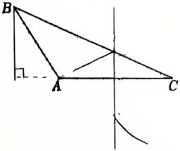

20. （5分）如图，在钝角 $\triangle ABC$ 中，$\angle BAC>90^{\circ}$。

（1）尺规作图：作 $AC$ 的垂直平分线，与边 $BC$、$AC$ 分别交于点 $D$、$E$（不写作法，保留作图痕迹）；

（2）在（1）的条件下，过点 $B$ 作 $BH\perp AC$ 交 $CA$ 的延长线于点 $H$，连接 $AD$，求证 $\angle ADE=\angle HBC$。请补全图形，并完成下列证明过程：

证明：∵ $DE$ 是 $AC$ 的垂直平分线，

$\therefore DA=\underline{\quad}$，$AE=CE$，

∴ $\angle ADE=\angle CDE$，（ ___ ）（填写文字依据），

$\because BH\perp AC$，$DE\perp AC$，

$\therefore \angle BHC=\angle DEC=90^{\circ}$

$\therefore DE\parallel BH$，

∴ ___ 。

$\therefore \angle ADE=\angle HBC$

> [!question]- 点击查看答案与解析
> 【答案】（1）作图略（作 $AC$ 的垂直平分线，分别交 $BC$、$AC$ 于 $D$、$E$）；（2）依次填：$DC$；等腰三角形底边上的中线、高线和顶角平分线互相重合（"三线合一"）；$\angle CDE=\angle HBC$（两直线平行，同位角相等）
> 
> 【考点】线段垂直平分线的性质与尺规作图、等腰三角形"三线合一"、平行线的判定与性质 → [[【初中数学知识点体系-人教版】#15-1 图形的轴对称]]
> 
> 【解析】
> （1）分别以 $A$、$C$ 为圆心，大于 $\frac{1}{2}AC$ 的长为半径画弧，两弧交于两点，过这两点作直线，即为 $AC$ 的垂直平分线，它与 $BC$ 的交点为 $D$，与 $AC$ 的交点为 $E$。
> 
> （2）补全证明：
> ∵ $DE$ 是 $AC$ 的垂直平分线，
> ∴ $DA=DC$，$AE=CE$（线段垂直平分线上的点到线段两端点的距离相等），
> ∴ $\angle ADE=\angle CDE$（等腰三角形底边上的中线、高线和顶角平分线互相重合，即"三线合一"），
> ∵ $BH\perp AC$，$DE\perp AC$，
> ∴ $\angle BHC=\angle DEC=90^{\circ}$，
> ∴ $DE\parallel BH$（在同一平面内，垂直于同一条直线的两条直线互相平行），
> ∴ $\angle CDE=\angle HBC$（两直线平行，同位角相等），
> ∴ $\angle ADE=\angle HBC$（等量代换）。
> 
> 【易错点】第一空只写 $DA=DC$ 却忽略它来自"垂直平分线的性质"；第二空的文字依据要写成"三线合一"而不是"等边对等角"（这里是 $DE$ 既是高又是中线，才得到角平分线）；最后一空要写清楚是由 $DE\parallel BH$ 得到的同位角相等，再等量代换。
