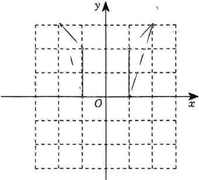

21. （5分）在平面直角坐标系 $xOy$ 中，$\triangle ABC$ 的三个顶点的坐标分别是 $A(2,3)$，$B(1,0)$，$C(1,2)$.

（1）请在图中作出 $\triangle ABC$ 及其关于 $y$ 轴对称的 $\triangle A_{1}B_{1}C_{1}$；

（2）以点 $B$、$C$、$D$ 为顶点的三角形与 $\triangle ABC$ 全等（点 $D$ 不与点 $A$ 重合），请直接写出所有符合条件的点 $D$ 坐标.

> [!question]- 点击查看答案与解析
> 【答案】（1）作图略，$A_1(-2,3)$，$B_1(-1,0)$，$C_1(-1,2)$；（2）$D(0,3)$，$D(0,-1)$，$D(2,-1)$
> 
> 【考点】关于 $y$ 轴对称的点的坐标、用坐标刻画图形、三角形全等的条件 → [[【初中数学知识点体系-人教版】#15-2 画轴对称的图形]]
> 
> 【解析】
> （1）关于 $y$ 轴对称的点，纵坐标不变、横坐标互为相反数：
> $A(2,3)\to A_1(-2,3)$，$B(1,0)\to B_1(-1,0)$，$C(1,2)\to C_1(-1,2)$。
> 在坐标系中描出 $A_1$、$B_1$、$C_1$ 并依次连接，即得 $\triangle A_1B_1C_1$（与原三角形关于 $y$ 轴对称）。
> 
> （2）由坐标可算得 $BC=2$，$AC=\sqrt{(2-1)^2+(3-2)^2}=\sqrt2$，$AB=\sqrt{(2-1)^2+3^2}=\sqrt{10}$。
> 因为 $\triangle BCD$ 与 $\triangle ABC$ 全等，且 $BC=2$ 是 $\triangle ABC$ 中唯一的长度为 $2$ 的边，所以边 $BC$ 只能与自身对应，
> 从而 $BD$、$CD$ 分别等于 $\sqrt{10}$、$\sqrt2$（或 $\sqrt2$、$\sqrt{10}$）。
> 设 $D(x,y)$，由 $B(1,0)$、$C(1,2)$ 得 $(x-1)^2+y^2$ 与 $(x-1)^2+(y-2)^2$ 分别取 $\sqrt{10}$、$\sqrt2$：
> ① 若 $BD^2=10$，$CD^2=2$，两式相减得 $(y-2)^2-y^2=-8$，即 $-4y+4=-8$，$y=3$，代入得 $(x-1)^2=1$，$x=2$ 或 $x=0$。
> 其中 $D(2,3)$ 就是点 $A$，不合题意，舍去，得 $D(0,3)$。
> ② 若 $BD^2=2$，$CD^2=10$，两式相减得 $(y-2)^2-y^2=8$，即 $-4y+4=8$，$y=-1$，代入得 $(x-1)^2=1$，$x=0$ 或 $x=2$。
> 得 $D(0,-1)$ 或 $D(2,-1)$。
> 所以符合条件的点 $D$ 共有三个：$(0,3)$，$(0,-1)$，$(2,-1)$。
> 
> 【易错点】第（2）题只画出关于直线 $BC$ 对称的一个点 $(2,-1)$，漏掉把 $\triangle ABC$ 沿 $BC$ 方向"平移式"翻转得到的 $(0,3)$、$(0,-1)$；还容易把点 $A(2,3)$ 本身当作答案，忽略"点 $D$ 不与点 $A$ 重合"。
