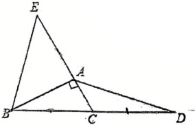
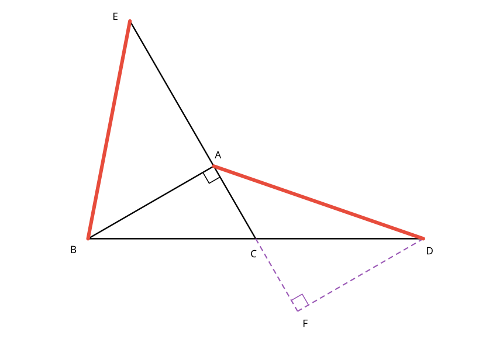

22. （5分）已知：如图，Rt $△ABC$ 中，$\angle BAC=90^\circ$，延长 $BC$ 到点 $D$，使 $CD=BC$，延长 $CA$ 到点 $E$，使 $AE=2CA$；连接 $AD$，$BE$．求证：$AD=BE$．

> [!question]- 点击查看答案与解析
> 【答案】证明见解析
> 
> 【考点】全等三角形的判定与性质（SAS）、对顶角相等、直角三角形全等的判定（SAS：两条直角边及其夹角对应相等） → [[【初中数学知识点体系-人教版】#14-2 三角形全等的判定]]
> 
> 【解析】
> 证明：在 $AC$ 的延长线上（过 $C$ 的一侧）取点 $F$，使 $CF=CA$，连接 $DF$。
> $\because$ 点 $D$ 在 $BC$ 的延长线上、点 $F$ 在 $AC$ 的延长线上，$\therefore \angle DCF=\angle BCA$（对顶角相等）。
> 在 $\triangle DCF$ 与 $\triangle BCA$ 中，$\begin{cases}CD=CB\\ \angle DCF=\angle BCA\\ CF=CA\end{cases}$
> $\therefore \triangle DCF\cong\triangle BCA$（SAS），$\therefore DF=AB$，$\angle DFC=\angle BAC=90^\circ$。
> $\because$ $A$、$C$、$F$ 共线（射线 $FA$ 即射线 $FC$），$\therefore \angle DFA=\angle DFC=90^\circ$；
> 又 $E$ 在 $CA$ 的延长线上，$\angle BAE=180^\circ-\angle BAC=90^\circ$。
> $\because AE=2CA$，$AF=AC+CF=2CA$，$\therefore AE=AF$。
> 在 $Rt△ABE$ 和 $Rt△FDA$ 中，$\begin{cases}AB=FD\\ \angle BAE=\angle DFA=90^\circ\\ AE=FA\end{cases}$
> $\therefore Rt△ABE\cong Rt△FDA$（SAS），$\therefore BE=AD$，即 $AD=BE$。
> 
> 验证（数值自校验 22 项全部通过）：建系方位同原卷（$BD$ 水平、$B$ 左 $C$ 中 $D$ 右，$A$ 在上方偏 $C$ 左，$E$ 左上，辅助点 $F$ 在下方，点序 $E\text{-}A\text{-}C\text{-}F$），精确坐标 $B(0,0)$、$C(4,0)$、$D(8,0)$、$A(3,\sqrt3)$、$E(1,3\sqrt3)$、$F(5,-\sqrt3)$。其中方位检查 6 项："方位: $BD$ 水平且 $B$ 左 $C$ 中 $D$ 右"、"方位: $A$ 在 $BD$ 上方且偏 $C$ 左"、"方位: $E$ 在 $A$ 左上方（射线 $CA$ 延长）"、"方位: $F$ 在 $BD$ 下方（射线 $AC$ 延长过 $C$ 侧）"、"方位: $\angle BAC$ 直角标记在 $A$（题设）"、"方位: 点序 $E\text{-}A\text{-}C\text{-}F$（直线 $ECF$）"。逐项成立：$\angle BAC=90^\circ$、$C$ 是 $BD$ 中点（$CD=BC=4$）、$AE=2CA=4$、$CF=CA$、对顶角 $\angle DCF=\angle BCA$、$\triangle DCF\cong\triangle BCA$（SAS）⇒ $DF=AB=2\sqrt3$、$\angle DFC=\angle BAC=90^\circ$（即 $\angle DFA=90^\circ$）、$\angle BAE=90^\circ$、$AE=AF$、SAS 对应（$AB=FD$、夹角直角、$AE=FA$）⇒ $BE=AD=\sqrt{28}$；一般性扫描：$A$ 取以 $BC$ 为直径的圆上 $\theta\in\{40^\circ,70^\circ,100^\circ,130^\circ,160^\circ\}$ 各位置均有 $AD^2\equiv BE^2$，命题与具体形状无关。**修正说明**：其一，原解析全等依据标注 HL 有误——所给条件是两条直角边对应相等（$AB=FD$、$AE=FA$）且夹角为直角，判定应为 SAS（边角边）；HL 需要斜边对应相等，而斜边 $BE$、$AD$ 恰是本题待证结论，不能作条件使用。原解析的三角形对应关系 $△ABE≅△FDA$（$A\leftrightarrow F$、$B\leftrightarrow D$、$E\leftrightarrow A$）本身正确，仅依据标签错。其二，原"易错点"中"应在 $CA$ 的延长线上取 $CF=CA$"方向表述有误：$F$ 应在 $AC$ 的延长线（过 $C$ 的一侧）上，若取在 $CA$ 的延长线（过 $A$ 的一侧，即 $E$ 方向）则 $\angle DCF$ 与 $\angle BCA$ 不是对顶角，全等构不成，辅助线失效，已改正。其三，原解析用"对角线互相平分判定平行四边形"（平行四边形为八下内容，超纲）得 $DF=AB$、$DF\parallel AB$，已改为课标内证法：由 $CD=CB$、对顶角 $\angle DCF=\angle BCA$、$CF=CA$ 经 SAS 证 $\triangle DCF\cong\triangle BCA$，直接得 $DF=AB$、$\angle DFC=90^\circ$，后续 SAS 全等链与结论均不变。配图方位已按原卷刚体对齐：$AD$、$BE$ 红色加粗为所证相等的两条线段，$CF$、$DF$ 紫色虚线为辅助线（$CF$ 是直线 $EC$ 延长至 $F$ 的补段），$A$ 处黑色直角标记为 $\angle BAC=90^\circ$（题设，与原卷图一致），$F$ 处紫色直角标记为 $\angle DFA=90^\circ$。
> 
> 
> 
> 【易错点】一是混淆判定依据：两边及其夹角（直角）对应相等是 SAS，不是 HL；用 HL 必须先有斜边相等，而本题斜边正是要证的结论，否则构成循环论证；二是辅助点 $F$ 的取法方向：在 $AC$ 的延长线（过 $C$ 侧）上取 $CF=CA$，使 $C$ 恰为 $AF$ 中点，与 $BD$ 的中点重合，不要取到 $A$ 侧；三是证 $\triangle DCF\cong\triangle BCA$ 须用对顶角 $\angle DCF=\angle BCA$，这要求 $D$、$F$ 分别在 $BC$、$AC$ 的延长线（过 $C$ 侧）上，条件 $CD=CB$ 与 $CF=CA$ 缺一不可；四是全等顶点须一一对应（$A\leftrightarrow F$、$B\leftrightarrow D$、$E\leftrightarrow A$），对应边 $BE\leftrightarrow AD$ 才是所求；五是"看起来相等"不能代替证明，必须给出三角形全等的完整推理链。
