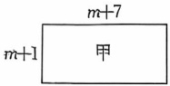
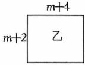

23. （5分）如图，甲长方形的两边长分别为 $m+1$，$m+7$，面积为 $S_{1}$，乙长方形的两边长分别为 $m+2$，$m+4$，面积为 $S_{2}$（其中 $m$ 为正整数）.

（1）$S_1=$ ___ ，$S_2=$ ___ （用含 $m$ 的多项式表示），$S_1$ ___ $S_2$（填“<”、“=”或“>”）；

（2）有一正方形，其周长与甲长方形周长相等，面积为 $S$，求证：$S-S_{1}$ 为定值.

> [!question]- 点击查看答案与解析
> 【答案】（1）$S_1=m^2+8m+7$，$S_2=m^2+6m+8$，$>$；（2）$S-S_1=9$，是定值，证明见解析
> 
> 【考点】多项式乘多项式、整式的加减、完全平方公式 → [[【初中数学知识点体系-人教版】#16-2 整式的乘法]]
> 
> 【解析】
> （1）$S_1=(m+1)(m+7)=m^2+7m+m+7=m^2+8m+7$；
> $S_2=(m+2)(m+4)=m^2+4m+2m+8=m^2+6m+8$。
> $S_1-S_2=(m^2+8m+7)-(m^2+6m+8)=2m-1$。
> 因为 $m$ 为正整数，所以 $m\geq1$，$2m-1\geq1>0$，故 $S_1>S_2$。
> 
> （2）甲长方形的周长为 $2[(m+1)+(m+7)]=2(2m+8)=4m+16$。
> 正方形的周长与它相等，所以正方形的边长为 $\frac{4m+16}{4}=m+4$，
> 面积 $S=(m+4)^2=m^2+8m+16$。
> 于是 $S-S_1=(m^2+8m+16)-(m^2+8m+7)=9$。
> 因为 $9$ 与 $m$ 的取值无关，所以 $S-S_1$ 为定值 $9$。
> 
> 【易错点】比较 $S_1$ 与 $S_2$ 时忘记说明 $m$ 为正整数这一条件；求正方形边长时把"周长相等"误当作"面积相等"；第（2）题没有把 $S-S_1$ 化简到不含 $m$ 就下结论。
