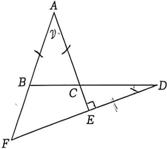
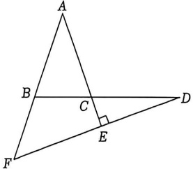
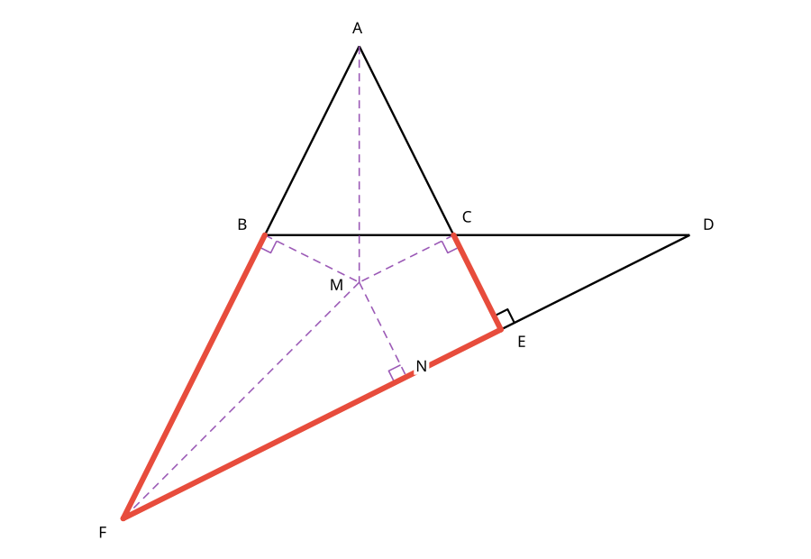

25. （6分）如图，在等腰 $\triangle ABC$ 中，$AB=AC$，点 $D$ 是 $BC$ 延长线上一点，过点 $D$ 作 $DE\perp AC$，分别交 $AC$，$AB$ 的延长线于点 $E$，点 $F$.

（1）求证：$\angle CDE=\frac{1}{2}\angle BAC$；

（2）若 $DE=AB$，用等式表示 $BF$，$CE$，$EF$ 的数量关系，并证明.

**（备用图）**

> [!question]- 点击查看答案与解析
> 【答案】（1）证明见解析；（2）$EF=BF+CE$，证明见解析
> 
> 【考点】等腰三角形的性质（等边对等角、三线合一）、直角三角形两锐角互余、对顶角、全等三角形的判定与性质（SSS/ASA/AAS/HL） → [[【初中数学知识点体系-人教版】#15-3 等腰三角形]]、[[【初中数学知识点体系-人教版】#14-2 三角形全等的判定]]
> 
> 【解析】
> （1）证明：∵ $AB=AC$，
> ∴ $\angle ABC=\angle ACB=\frac{180^{\circ}-\angle BAC}{2}=90^{\circ}-\frac{1}{2}\angle BAC$。
> ∵ 点 $D$ 在 $BC$ 的延长线上，点 $E$ 在 $AC$ 的延长线上，
> ∴ $\angle DCE=\angle ACB=90^{\circ}-\frac{1}{2}\angle BAC$（对顶角相等）。
> ∵ $DE\perp AC$，∴ $\angle CED=90^{\circ}$，
> ∴ 在 $Rt\triangle CDE$ 中，$\angle CDE=90^{\circ}-\angle DCE=90^{\circ}-\left(90^{\circ}-\frac{1}{2}\angle BAC\right)=\frac{1}{2}\angle BAC$。
> 
> （2）数量关系为 $EF=BF+CE$。
> 证明：过点 $C$ 作 $CM\perp AE$，交 $\angle BAC$ 的平分线于点 $M$，连接 $MB$、$MF$、$ME$；过点 $M$ 作 $MN\perp EF$ 于点 $N$。
> ∵ $AB=AC$ 且 $AM$ 平分顶角 $\angle BAC$，∴ $AM$ 是底边 $BC$ 的垂直平分线（三线合一），∴ $MB=MC$。
> 在 $\triangle AMB$ 和 $\triangle AMC$ 中，$\begin{cases}AB=AC\\ MB=MC\\ AM=AM\end{cases}$，∴ $\triangle AMB\cong\triangle AMC$（SSS），∴ $\angle ABM=\angle ACM$。
> ∵ $CM\perp AE$，∴ $\angle ACM=90^{\circ}$，∴ $\angle ABM=90^{\circ}$，即 $MB\perp AF$。
> 设 $\angle BAC=2\alpha$。由（1）知 $\angle CDE=\alpha=\angle CAM$（$AM$ 平分 $\angle BAC$）。
> 在 $\triangle DEC$ 和 $\triangle ACM$ 中，$\begin{cases}\angle CDE=\angle CAM\\ DE=AC\ (\because DE=AB=AC)\\ \angle DEC=\angle ACM=90^{\circ}\end{cases}$，
> ∴ $\triangle DEC\cong\triangle ACM$（ASA），∴ $CE=CM$。
> ∴ $\triangle MCE$ 是等腰直角三角形，$\angle MEC=45^{\circ}$。又 $\angle AEF=90^{\circ}$（即 $\angle CEF$，点 $C$ 在线段 $AE$ 上），
> ∴ $\angle MEF=\angle AEF-\angle MEC=45^{\circ}=\angle MEC$，即 $EM$ 平分 $\angle AEF$。
> 在 $\triangle MEC$ 和 $\triangle MEN$ 中，$\begin{cases}\angle MEC=\angle MEN\\ \angle MCE=\angle MNE=90^{\circ}\\ ME=ME\end{cases}$，∴ $\triangle MEC\cong\triangle MEN$（AAS），∴ $MN=MC$，$EN=EC$。
> ∴ $MB=MN$。
> 在 $Rt\triangle MFB$ 和 $Rt\triangle MFN$ 中，$\begin{cases}FM=FM\\ MB=MN\end{cases}$，∴ $Rt\triangle MFB\cong Rt\triangle MFN$（HL），∴ $FB=FN$。
> ∴ $EF=EN+NF=CE+BF$，即 $EF=BF+CE$。
> 
> 验证（数值自校验 34 项全部通过）：建系方位同原卷（$BD$ 水平、$B$ 左 $C$ 中 $D$ 右，$A$ 在上方，$E$ 在 $BD$ 下方直角处，$F$ 左下），精确坐标 $B(-1,0)$、$C(1,0)$、$A(0,2)$、$D(3.5,0)$、$E(1.5,-1)$、$F(-2.5,-3)$、辅助点 $M(0,-0.5)$、$N(0.5,-1.5)$。逐项成立：$AB=AC=\sqrt5$、$\angle ACB=90^{\circ}-\tfrac12\angle BAC$、$\angle DCE$ 与 $\angle ACB$ 为对顶角、$\angle CED=90^{\circ}$、$\angle CDE=26.57^{\circ}=\tfrac12\angle BAC$；点序 $B\text{-}C\text{-}D$、$A\text{-}C\text{-}E$、$A\text{-}B\text{-}F$、$F\text{-}E\text{-}D$，$DE=AB=\sqrt5$；$MB=MC$、$AM$ 平分 $\angle BAC$ 且 $AM\perp BC$、$\angle ACM=\angle ABM=90^{\circ}$、$\triangle DEC\cong\triangle ACM$（ASA）⇒ $CE=CM=0.5\sqrt5$、$\angle MEC=\angle MEF=45^{\circ}$、$\triangle MEC\cong\triangle MEN$（AAS）⇒ $MN=MC$、$EN=EC$、$MB=MN=\sqrt{1.25}$、$Rt\triangle MFB\cong Rt\triangle MFN$（HL）⇒ $FB=FN=1.5\sqrt5$；最终 $EF=2\sqrt5=BF+CE=1.5\sqrt5+0.5\sqrt5$ ✓。方位检查 7 项："方位: $BD$ 水平且 $B$ 左 $C$ 中 $D$ 右"、"方位: $A$ 在 $BD$ 上方"、"方位: $E$ 在 $BD$ 下方、直角标记在 $E$"、"方位: $F$ 在左下"、"方位: 点序 $F\text{-}E\text{-}D$、$A\text{-}C\text{-}E$、$A\text{-}B\text{-}F$"、"方位: 辅助点 $M$、$N$ 均在 $BD$ 下方"、"方位: $\angle BAC$ 为锐角"。一般性扫描：$\alpha\in\{15^{\circ},25^{\circ},35^{\circ},40^{\circ}\}$（$2\alpha<90^{\circ}$，与原卷构型一致）时按 $DE=AB$ 重新定 $D$，均有 $\angle CDE=\alpha$ 且 $EF\equiv BF+CE$，命题与具体形状无关。**修正说明**：原解析第（2）问用锐角三角函数（$\tan$、$\sec$）与二倍角恒等变形证明，超出八年级上学期课程范围（三角函数为九年级内容），已替换为纯八上工具的综合证法：作顶角平分线（即底边垂直平分线）与过 $C$ 的垂线定出点 $M$，再作 $MN\perp EF$，通过 SSS、ASA、AAS、HL 四次全等把 $EF$ 拆成 $EN+NF$ 并分别代换为 $CE$、$BF$。第（1）问原解析正确，保留。配图方位已按原卷刚体对齐：$EF$、$BF$、$CE$ 红色加粗为构成数量关系的三条线段，$AM$、$CM$、$BM$、$MN$、$MF$ 紫色虚线为辅助线，$E$ 处黑色直角标记为题设 $DE\perp AC$，$B$、$C$、$N$ 处紫色直角标记为辅助线产生的垂足。
> 
> 
> 
> 【易错点】一是第（1）问忘记 $E$、$D$ 都在延长线上，把 $\angle DCE$ 与 $\angle ACB$ 当成同一个角（实为对顶角）；二是第（2）问容易凭图形猜测成 $EF=BF-CE$ 或 $BF=EF+CE$，应先判断 $EF$ 最长、$CE$ 最短；三是辅助点 $M$ 的取法：过 $C$ 作 $AC$ 的垂线，与顶角平分线（即 $BC$ 的垂直平分线）相交得到，两条线都要说明依据；四是使用 $HL$ 时斜边 $FM$ 是公共边（已知相等），不是待证结论，不构成循环论证，而 $FB=FN$ 才是结论；五是全等三角形顶点须一一对应（$\triangle DEC\cong\triangle ACM$ 中 $D\leftrightarrow A$、$E\leftrightarrow C$、$C\leftrightarrow M$），对应边 $CE\leftrightarrow CM$ 才能完成代换。
