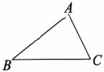
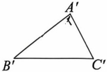

如图，$AB=A'B'$，$\angle A=\angle A'$，若要使 $\triangle ABC \cong \triangle A'B'C'$，还需要（ ）.

A. $\angle B=\angle B'$

B. $\angle C=\angle C'$

C. $AC=A'C'$

D. 以上选项均可

> [!question]- 点击查看答案与解析
> **【答案】** D
> **【考点】** [[【初中数学知识点体系-人教版】#14-2 三角形全等的判定]]
> **【解析】**
> 已知 $AB=A'B'$，$\angle A=\angle A'$
> - 选项A：若 $\angle B=\angle B'$，根据ASA（角边角），可判定 $\triangle ABC \cong \triangle A'B'C'$
> - 选项B：若 $\angle C=\angle C'$，根据AAS（角角边），可判定 $\triangle ABC \cong \triangle A'B'C'$
> - 选项C：若 $AC=A'C'$，根据SAS（边角边），可判定 $\triangle ABC \cong \triangle A'B'C'$
> - 因此以上选项均可，选D
> **【易错点】** 混淆全等三角形的判定方法，不能准确识别对应边角关系。
