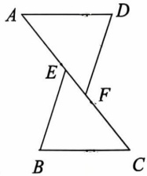

如图，点 $E$，$F$ 在 $AC$ 上，$AF=CE$，$AD=CB$，下列条件中不能推断 $\triangle ADF \cong \triangle CBE$ 的是（ ）.

A. $\angle D=\angle B$

B. $\angle A=\angle C$

C. $BE=DF$

D. $AD \parallel BC$

> [!question]- 点击查看答案与解析
> **【答案】** C
> **【考点】** [[【初中数学知识点体系-人教版】#14-2 三角形全等的判定]]
> **【解析】**
> 已知 $AF=CE$，$AD=CB$，即 $AE+EF=CF+EF$，$AE=CF$
> - 选项A：$\angle D=\angle B$，结合 $AD=CB$，$AE=CF$，可用SAS判定全等
> - 选项B：$\angle A=\angle C$，结合 $AD=CB$，$AE=CF$，可用SAS判定全等
> - 选项C：$BE=DF$，这是SSA（边边角），不能判定全等
> - 选项D：$AD \parallel BC$，可得 $\angle A=\angle C$，同选项B
> **【易错点】** 误认为SSA可以判定全等，实际上SSA不是全等三角形的判定方法。
