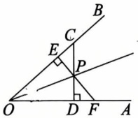

如图，$OP$ 平分 $\angle AOB$，$PD \perp OA$ 于点 $D$，$PE \perp OB$ 于点 $E$，且 $DP$，$EP$ 的延长线分别交 $OB$，$OA$ 于点 $C$，$F$. 下列结论中 $\underset{\cdot}{错}\underset{\cdot}{误}$ 的是（ ）.

A. $PD=PE$

B. $OD=OE$

C. $\angle DPO=\angle EPO$

D. $PD=CP$

> [!question]- 点击查看答案与解析
> **【答案】** D
> **【考点】** [[【初中数学知识点体系-人教版】#14-3 角的平分线]]
> **【解析】**
> - $OP$ 平分 $\angle AOB$，$PD \perp OA$，$PE \perp OB$
> - 根据角平分线上的点到角两边距离相等，$PD=PE$，选项A正确
> - 在 $\triangle OPD$ 和 $\triangle OPE$ 中，$OP=OP$，$PD=PE$，$\angle ODP=\angle OEP=90^\circ$
> - 根据HL，$\triangle OPD \cong \triangle OPE$，所以 $OD=OE$，选项B正确
> - 由全等可得 $\angle DPO=\angle EPO$，选项C正确
> - $PD=CP$ 不一定成立，选项D错误
> **【易错点】** 不能准确应用角平分线的性质，或在证明全等时条件找不全。
