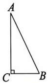
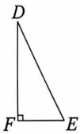

如图，在 $\triangle ABC$ 和 $\triangle DEF$ 中，$\angle C=\angle F=90^\circ$，添加下列条件，$\underset{\cdot}{不}\underset{\cdot}{能}$ 判定这两个三角形全等的是（ ）.

A. $\angle A=\angle D$，$\angle B=\angle E$

B. $AC=DF$，$AB=DE$

C. $\angle A=\angle D$，$AB=DE$

D. $AC=DF$，$CB=FE$

> [!question]- 点击查看答案与解析
> **【答案】** A
> **【考点】** [[【初中数学知识点体系-人教版】#14-2 三角形全等的判定]]
> **【解析】**
> 已知 $\angle C=\angle F=90^\circ$
> - 选项A：$\angle A=\angle D$，$\angle B=\angle E$，这是AAA（角角角），不能判定全等
> - 选项B：$AC=DF$，$AB=DE$，根据HL（斜边直角边），可判定全等
> - 选项C：$\angle A=\angle D$，$AB=DE$，根据AAS，可判定全等
> - 选项D：$AC=DF$，$CB=FE$，根据SAS，可判定全等
> **【易错点】** 混淆直角三角形的特殊判定方法（HL），或误认为AAA可以判定全等。
