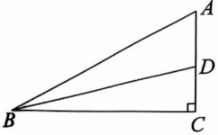

如图，在 $\triangle ABC$ 中，$\angle C=90^\circ$"，$BD$ 平分 $\angle ABC$ 交 $AC$ 于点 $D$. 若 $CD=n$，$AB=m$，则 $\triangle ABD$ 的面积是（ ）.

A. $\frac{1}{3}mn$

B. $\frac{1}{2}mn$

C. $mn$

D. $2mn$

> [!question]- 点击查看答案与解析
> **【答案】** B
> **【考点】** [[【初中数学知识点体系-人教版】#14-3 角的平分线]]
> **【解析】**
> - $\angle C=90^\circ$，$BD$ 平分 $\angle ABC$，$CD=n$
> - 过点 $D$ 作 $DE \perp AB$ 于点 $E$
> - 根据角平分线的性质，$DE=CD=n$
> - $\triangle ABD$ 的面积 $=\frac{1}{2} \times AB \times DE=\frac{1}{2} \times m \times n=\frac{1}{2}mn$
> **【易错点】** 不能想到作辅助线，或不能正确应用角平分线的性质求高。
