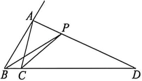

如图，在 $\triangle ABC$ 中，$AD$ 是 $\triangle ABC$ 的外角平分线，$P$ 是 $AD$ 上异于点 $A$ 的任意一点，设 $PB=m$，$PC=n$，$AB=c$，$AC=b$，则 $(m+n)$ 与 $(b+c)$ 的大小关系是（ ）.

A. $m+n=b+c$

B. $m+n<b+c$

C. $m+n>b+c$

D. 无法确定

> [!question]- 点击查看答案与解析
> **【答案】** C
> **【考点】** [[【初中数学知识点体系-人教版】#13-2 与三角形有关的线段]]
> **【解析】**
> 在 $\triangle ABP$ 中，$PA+PB>AB$，即 $PA+m>c$
> 在 $\triangle ACP$ 中，$PA+PC>AC$，即 $PA+n>b$
> 两式相加：$2PA+m+n>b+c$
> 因为 $PA>0$，所以 $m+n>b+c$
> **【易错点】** 不能正确构造三角形并应用三边关系，或在不等式变形时出错。
