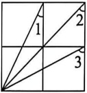

如图，已知方格纸中是 $4$ 个相同的小正方形，则 $\angle 1+\angle 2+\angle 3=$ ___ .

> [!question]- 点击查看答案与解析
> **【答案】** $135^\circ$
> **【考点】** [[【初中数学知识点体系-人教版】#14-1 全等三角形及其性质]]
> **【解析】**
> 设小正方形的边长为 $a$。
> - $\angle 2$ 是正方形对角线与边的夹角，所以 $\angle 2 = 45^\circ$
> - $\angle 1$ 所在直角三角形的两直角边分别为 $a$ 和 $2a$
> - $\angle 3$ 所在直角三角形的两直角边分别为 $2a$ 和 $a$
> - 这两个直角三角形全等（SAS：$a$，$90^\circ$，$2a$）
> - 在 $\angle 1$ 所在的直角三角形中，设另一个锐角为 $\angle 1'$，则 $\angle 1 + \angle 1' = 90^\circ$
> - $\angle 1'$ 的对边为 $2a$，邻边为 $a$
> - $\angle 3$ 的对边为 $2a$，邻边为 $a$
> - 因为两个三角形全等，对应角相等，所以 $\angle 3 = \angle 1'$
> - 因此 $\angle 1 + \angle 3 = \angle 1 + \angle 1' = 90^\circ$
> - 最终 $\angle 1 + \angle 2 + \angle 3 = 90^\circ + 45^\circ = 135^\circ$
> **【易错点】** 不能准确识别各角所在的直角三角形，或忽略 $\angle 1$ 与 $\angle 3$ 之间的关系。
