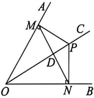

如图，$P$ 为 $\angle AOB$ 的平分线 $OC$ 上任意一点，$PM \perp OA$ 于点 $M$，$PN \perp OB$ 于点 $N$，连接 $MN$ 交 $OP$ 于点 $D$. 下列四个结论：$①$ $PM=PN$；$②$ $MO=NO$；$③$ $OP \perp MN$；$④$ $MD=ND$，其中正确的是 ___ （填所有正确的序号）.

> [!question]- 点击查看答案与解析
> **【答案】** $①②③④$
> **【考点】** [[【初中数学知识点体系-人教版】#14-3 角的平分线]]
> **【解析】**
> - $P$ 在 $\angle AOB$ 的平分线 $OC$ 上，$PM \perp OA$，$PN \perp OB$
> - 根据角平分线的性质，$PM=PN$，$①$ 正确
> - 在 $\triangle OPM$ 和 $\triangle OPN$ 中，$OP=OP$，$PM=PN$，$\angle OMP=\angle ONP=90^\circ$
> - 根据HL，$\triangle OPM \cong \triangle OPN$，所以 $MO=NO$，$②$ 正确
> - 由全等可得 $\angle MOP=\angle NOP$，$OP$ 是 $\angle MON$ 的平分线
> - 又 $OM=ON$，所以 $OP \perp MN$，$③$ 正确
> - 由 $OP \perp MN$ 和 $OM=ON$，可得 $MD=ND$，$④$ 正确
> **【易错点】** 不能准确应用角平分线的性质，或在证明垂直时逻辑不清晰。
