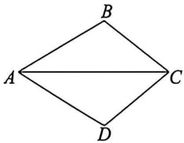

如图，在四边形 $ABCD$ 中，$AB=AD$. 添加一个条件使得 $\triangle ABC \cong \triangle ADC$，可添加的条件是 ___ .

> [!question]- 点击查看答案与解析
> **【答案】** $BC=DC$ 或 $\angle BAC=\angle DAC$ 或 $\angle B=\angle D$
> **【考点】** [[【初中数学知识点体系-人教版】#14-2 三角形全等的判定]]
> **【解析】**
> 已知 $AB=AD$，$AC=AC$（公共边）
> - 若添加 $BC=DC$，根据SSS，$\triangle ABC \cong \triangle ADC$
> - 若添加 $\angle BAC=\angle DAC$，根据SAS，$\triangle ABC \cong \triangle ADC$
> - 若添加 $\angle B=\angle D$，根据AAS，$\triangle ABC \cong \triangle ADC$
> **【易错点】** 不能准确找出已有的条件，或添加的条件不能构成全等判定。
