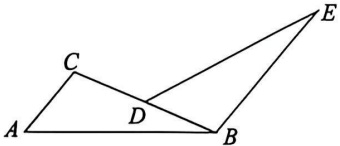

如图，点 $D$ 在 $\triangle ABC$ 的边 $BC$ 上，$AC \parallel BE$，$BC=BE$，$\angle ABC=\angle E$. 求证：$AB=DE$.

> [!question]- 点击查看答案与解析
> **【答案】** 证明见解析
> **【考点】** [[【初中数学知识点体系-人教版】#14-2 三角形全等的判定]]
> **【解析】**
> 证明：$\because AC \parallel BE$
> $\therefore \angle ACB=\angle EBC$（两直线平行，内错角相等）
> 在 $\triangle ABC$ 和 $\triangle DEB$ 中：
> $\begin{cases}\angle ABC=\angle E\\BC=BE\\\angle ACB=\angle EBC\end{cases}$
> $\therefore \triangle ABC \cong \triangle DEB$（ASA）
> $\therefore AB=DE$
> **【易错点】** 不能准确找出对应角，或在证明全等时条件找不全。
