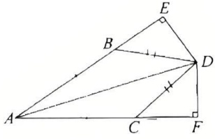

如图，$AB=AC$，$BD=CD$，$DE \perp AB$，垂足为点 $E$，$DF \perp AC$，垂足为点 $F$. 求证：$DE=DF$.

> [!question]- 点击查看答案与解析
> **【答案】** 证明见解析
> **【考点】** [[【初中数学知识点体系-人教版】#15-3 等腰三角形]]
> **【解析】**
> 证明：连接 $AD$
> $\because AB=AC$，$BD=CD$
> $\therefore AD$ 是 $\triangle ABC$ 的中线
> $\therefore AD$ 平分 $\angle BAC$（等腰三角形三线合一）
> $\because DE \perp AB$，$DF \perp AC$
> $\therefore DE=DF$（角平分线上的点到角两边距离相等）
> **【易错点】** 不能想到连接 $AD$ 构造辅助线，或不能应用等腰三角形的性质。
