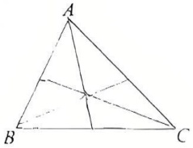

已知：如图，$\triangle ABC$.

求作：点 $P$，使得点 $P$ 在 $\triangle ABC$ 内，且到三边 $AB$，$BC$，$CA$ 的距离相等.

> [!question]- 点击查看答案与解析
> **【答案】** 作图见解析
> **【考点】** [[【初中数学知识点体系-人教版】#14-3 角的平分线]]
> **【解析】**
> 作法：
> 1. 作 $\angle BAC$ 的平分线 $AD$
> 2. 作 $\angle ABC$ 的平分线 $BE$
> 3. $AD$ 与 $BE$ 的交点即为所求点 $P$
> 理由：角平分线上的点到角两边距离相等，两条角平分线的交点到三边距离相等
> **【易错点】** 不能准确进行尺规作图，或不理解作图的原理。
