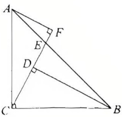

如图，在 $\triangle ABC$ 中，$AC=BC$，$\angle ACB=90^\circ$，$AF \perp CF$ 于点 $F$，$CF$ 交 $AB$ 于点 $E$，$BD \perp CF$ 于点 $D$.求证：$BD=AF+DF$

> [!question]- 点击查看答案与解析
> **【答案】** 证明见解析
> **【考点】** [[【初中数学知识点体系-人教版】#14-2 三角形全等的判定]]
> **【解析】**
> 证明：$\because AC=BC$，$\angle ACB=90^\circ$
> $\therefore \angle CAB=\angle CBA=45^\circ$
> $\because AF \perp CF$，$BD \perp CF$
> $\therefore \angle AFC=\angle BDC=90^\circ$
> 在 $\triangle ACF$ 和 $\triangle CBD$ 中：
> $\left\{\begin{array}{l}\angle AFC=\angle BDC=90^\circ\\\angle ACF=\angle BCD\\AC=BC\end{array}\right.$
> $\therefore \triangle ACF \cong \triangle CBD$（AAS）
> $\therefore AF=CD$，$CF=BD$
> $\because CF=CD+DF$
> $\therefore BD=AF+DF$
> **【易错点】** 不能准确找出全等三角形，或在证明线段关系时逻辑不清晰。
