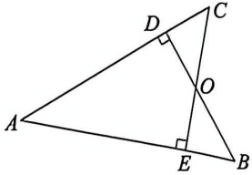

如图，$AB=AC$，$BD \perp AC$ 于点 $D$，$CE \perp AB$ 于点 $E$，$BD$，$CE$ 交于点 $O$. 求证：$OD=OE$.

> [!question]- 点击查看答案与解析
> **【答案】** 证明见解析
> **【考点】** [[【初中数学知识点体系-人教版】#14-2 三角形全等的判定]]
> **【解析】**
> 证明：$\because AB=AC$
> $\therefore \angle ABC=\angle ACB$
> $\because BD \perp AC$，$CE \perp AB$
> $\therefore \angle BDC=\angle CEB=90^\circ$
> 在 $\triangle BDC$ 和 $\triangle CEB$ 中：
> $\left\{\begin{array}{l}\angle BDC=\angle CEB=90^\circ\\\angle BCD=\angle CBE\\BC=CB\end{array}\right.$
> $\therefore \triangle BDC \cong \triangle CEB$（AAS）
> $\therefore BD=CE$，$CD=BE$
> 在 $\triangle BOD$ 和 $\triangle COE$ 中：
> $\left\{\begin{array}{l}\angle BDO=\angle CEO=90^\circ\\\angle BOD=\angle COE\\BD=CE\end{array}\right.$
> $\therefore \triangle BOD \cong \triangle COE$（AAS）
> $\therefore OD=OE$
> **【易错点】** 不能准确找出全等三角形，或证明过程过于复杂。
