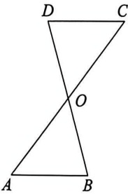

如图，$AC$，$BD$ 相交于点 $O$，请从下列三个选项中选出两个作为条件，另一个作为结论，写出真命题，并证明.

$①$ $OA=OC$；$②$ $OB=OD$；$③$ $AB \parallel CD$.

> [!question]- 点击查看答案与解析
> **【答案】** 选 $①②$ 为条件，$③$ 为结论（或其他组合）
> **【考点】** [[【初中数学知识点体系-人教版】#14-2 三角形全等的判定]]
> **【解析】**
> 已知：$OA=OC$，$OB=OD$
> 求证：$AB \parallel CD$
> 证明：在 $\triangle AOB$ 和 $\triangle COD$ 中：
> $\begin{cases}OA=OC\\\angle AOB=\angle COD\\OB=OD\end{cases}$
> $\therefore \triangle AOB \cong \triangle COD$（SAS）
> $\therefore \angle A=\angle C$
> $\therefore AB \parallel CD$（内错角相等，两直线平行）
> **【易错点】** 不能准确选择条件和结论，或在证明平行时方法不当。
