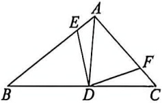
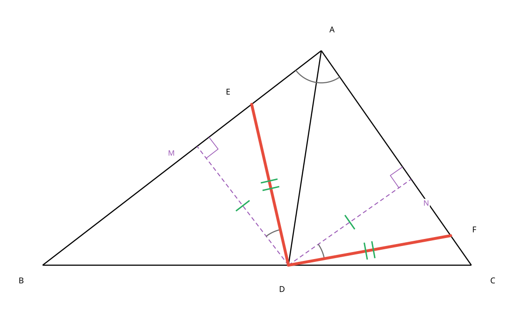

如图，$AD$ 是 $\triangle ABC$ 的角平分线，点 $E$，$F$ 分别在 $AB$，$AC$ 上，$\angle EDF+\angle EAF=180^\circ$. 试判断 $DE$ 与 $DF$ 的数量关系，并证明.

> [!question]- 点击查看答案与解析
> 【答案】$DE=DF$
> 
> 【考点】角平分线的性质（角平分线上的点到角两边的距离相等）、全等三角形的判定（ASA）与性质、四边形内角和 → [[【初中数学知识点体系-人教版】#14-3 角的平分线]]
> 
> 【解析】
> 判断：$DE=DF$。证明如下：
> 过点 $D$ 作 $DM\perp AB$ 于点 $M$，$DN\perp AC$ 于点 $N$。
> $\because AD$ 是 $\triangle ABC$ 的角平分线，$DM\perp AB$，$DN\perp AC$，
> $\therefore DM=DN$（角平分线上的点到角两边的距离相等）。
> 在四边形 $AMDN$ 中，$\angle AMD=\angle AND=90^\circ$，内角和为 $360^\circ$，
> $\therefore \angle MDN+\angle MAN=180^\circ$。
> 又已知 $\angle EDF+\angle EAF=180^\circ$，且 $\angle MAN$ 与 $\angle EAF$ 是同一个角，
> $\therefore \angle EDF=\angle MDN$。
> 由图，射线 $DE$ 在 $\angle MDN$ 内部，射线 $DN$ 在 $\angle EDF$ 内部，
> $\therefore \angle MDE=\angle MDN-\angle EDN=\angle EDF-\angle EDN=\angle NDF$。
> 在 $\triangle DME$ 和 $\triangle DNF$ 中：$\angle DME=\angle DNF=90^\circ$，$DM=DN$，$\angle MDE=\angle NDF$，
> $\therefore \triangle DME\cong\triangle DNF$（ASA），
> $\therefore DE=DF$（全等三角形对应边相等）。
> 
> 验证（数值自校验 15 项全部通过）：取 $B(0,0)$、$C(10,0)$、$A(6.5,5)$，由角平分线定理 $BD:DC=AB:AC$ 得 $D(5.733,0)$；在 $AB$ 上取 $AE=2.05$（$E$ 靠近 $A$），由 $\angle EDF=180^\circ-\angle A$ 解得 $F$ 在 $AC$ 上且 $AF=5.26$（$F$ 靠近 $C$，与原卷图位一致）。此时 $\angle A=87.42^\circ$、$\angle EDF=92.58^\circ$，垂足 $M$、$N$ 满足 $DM=DN\approx 3.496$、$\angle MDN=\angle EDF$、$\angle MDE=\angle NDF\approx 24.68^\circ$，且 $DE=DF=3.847$ 严格相等；$\angle AED+\angle AFD=180^\circ$ 亦成立。配图方位与原卷一致：$B$ 左下、$C$ 右下、$A$ 上偏右、$D$ 在 $BC$ 中部、$E$ 在 $AB$ 靠近 $A$、$F$ 在 $AC$ 靠近 $C$；紫色虚线为辅助线 $DM$、$DN$（绿色单刻线表示 $DM=DN$），$DE$、$DF$ 红色加粗（绿色双刻线表示 $DE=DF$），$D$ 处两枚同半径角弧表示 $\angle MDE=\angle NDF$。
> 
> 
> 
> 【易错点】一是辅助线方向：应过 $D$ 向角的两边 $AB$、$AC$ 作垂线，利用"角平分线上的点到角两边距离相等"得 $DM=DN$，而不是向 $BC$ 作垂线；二是角度转换的正确链是"$\angle MDN=180^\circ-\angle A=\angle EDF$，再同减公共角 $\angle EDN$ 得 $\angle MDE=\angle NDF$"，直接写"$\angle EDM+\angle FDN=90^\circ$"是没有依据的（数值上 $\angle EDM=\angle FDN\approx 24.7^\circ$，其和并非 $90^\circ$）；三是全等用 ASA（夹 $DM$、$DN$ 的两角），对应关系为 $M\leftrightarrow N$、$E\leftrightarrow F$；四是若 $E$、$F$ 位置互换（$\angle AED$ 与 $\angle AFD$ 一大一小对调），同理可证，结论不变。
