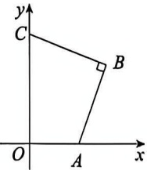
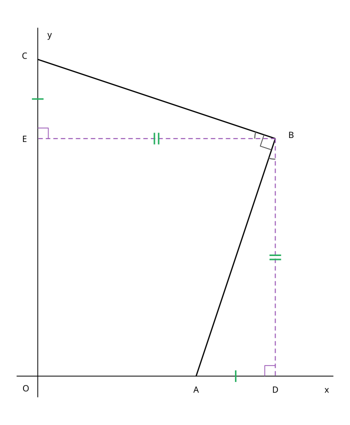

如图，在平面直角坐标系 $xOy$ 中，$\angle ABC=90^\circ$，$AB=BC$. 若点 $A(6,0)$，$C(0,12)$，求点 $B$ 的坐标.

> [!question]- 点击查看答案与解析
> 【答案】$B(9,9)$
> 
> 【考点】坐标系中构造全等三角形（"K字形"／三垂线模型）、全等三角形的判定（AAS）与性质 → [[【初中数学知识点体系-人教版】#14-2 三角形全等的判定]]
> 
> 【解析】
> 过点 $B$ 作 $BD\perp x$ 轴于点 $D$，$BE\perp y$ 轴于点 $E$。
> $\because$ 两坐标轴互相垂直，$BD\perp x$ 轴，$BE\perp y$ 轴，
> $\therefore$ 四边形 $ODBE$ 是矩形，$\angle DBE=90^\circ$。
> 由图可知射线 $BE$ 在 $\angle ABC$ 内部，射线 $BA$ 在 $\angle DBE$ 内部，
> $\therefore \angle ABE+\angle EBC=\angle ABC=90^\circ$，$\angle ABE+\angle ABD=\angle DBE=90^\circ$，
> $\therefore \angle ABD=\angle CBE$（同角的余角相等）。
> 在 $\triangle ABD$ 和 $\triangle CBE$ 中：$\angle BDA=\angle BEC=90^\circ$，$\angle ABD=\angle CBE$，$AB=CB$，
> $\therefore \triangle ABD\cong\triangle CBE$（AAS），
> $\therefore BD=BE$，$AD=CE$（全等三角形对应边相等）。
> 设 $B(x,y)$（由图，$x>0$，$y>0$），则 $D(x,0)$，$E(0,y)$，
> $BD=y$，$BE=x$，$AD=x-6$，$CE=12-y$。
> 由 $BD=BE$ 得 $x=y$；由 $AD=CE$ 得 $x-6=12-y$，即 $x+y=18$。
> 联立解得 $x=y=9$，$\therefore B(9,9)$。
> 
> 验证（数值自校验 15 项全部通过）：$B(9,9)$ 时 $\overrightarrow{BA}\cdot\overrightarrow{BC}=(-3,-9)\cdot(-9,3)=0$（$\angle ABC=90^\circ$）、$AB=BC=3\sqrt{10}$；垂足 $D(9,0)$、$E(0,9)$ 满足 $\angle BDA=\angle BEC=\angle DBE=90^\circ$，$\angle ABD=\angle CBE\approx 18.43^\circ$（经 $\angle ABE=71.57^\circ$ 两次互余转换），$BD=BE=9$、$AD=CE=3$，AAS 全等条件逐项成立。注意代数上 $B'(-3,3)$ 也满足 $\angle ABC=90^\circ$ 且 $AB=BC$，但不在第一象限、与题图不符，应舍去。配图方位与原卷一致：$O$ 左下、$A$ 在 $x$ 轴、$C$ 在 $y$ 轴高处、$B$ 在右侧；紫色虚线为辅助线 $BD$、$BE$，绿色单刻线表示 $AD=CE$、双刻线表示 $BD=BE$，$B$ 处两枚等角弧表示 $\angle ABD=\angle CBE$。
> 
> 
> 
> 【易错点】一是角度转换易错：$\angle ABD=\angle CBE$ 要经"同角 $\angle ABE$ 的余角相等"两步推出，直接写 $\angle ABD+\angle DBC=90^\circ$ 是不成立的（$\angle DBC$ 实为钝角）；二是全等对应关系要配对 $\triangle ABD\cong\triangle CBE$（$A\leftrightarrow C$、$D\leftrightarrow E$），错配会得出 $BD=CE$ 等错误等式；三是线段长要带图位条件：$AD=x-6$、$CE=12-y$ 依赖 $D$ 在 $A$ 右侧、$E$ 在 $C$ 下方；四是只看数量条件会漏舍 $B'(-3,3)$，必须用"如图"的位置信息确定第一象限的解。
