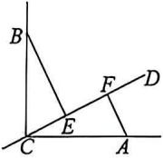
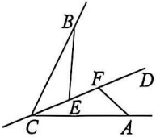
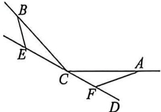

已知 $CD$ 是经过 $\angle BCA$ 顶点 $C$ 的一条直线，$CA=CB$，$E$，$F$ 分别是直线 $CD$ 上两点，且 $\angle BEC=\angle CFA=\angle \alpha$.

图1 

图2 

图3 

（1）若直线 $CD$ 经过 $\angle BCA$ 的内部，且 $E$，$F$ 两点在射线 $CD$ 上.

$①$ 如图1，若 $\angle BCA=90^\circ$，$\angle \alpha=90^\circ$，则 $BE$ ___ $CF$，$EF$ ___ $|BE-AF|$（填"＞""＝"或"＜"）；

$②$ 如图2，若 $0^\circ<\angle BCA<90^\circ$，请添加一个关于 $\angle \alpha$ 与 $\angle BCA$ 关系的条件，使 $①$ 中的两个结论仍然成立，并证明这两个结论；

（2）如图3，若 $90^\circ<\angle BCA<180^\circ$，直线 $CD$ 经过 $\angle BCA$ 的外部，$\angle \alpha=\angle BCA$，用等式表示线段 $EF$，$BE$，$AF$ 之间的数量关系，并直接写出结果.

> [!question]- 点击查看答案与解析
> **【答案】** （1）$①$ $=$，$=$；$②$ $\angle \alpha+\angle BCA=180^\circ$；（2）$EF=BE+AF$
> **【考点】** [[【初中数学知识点体系-人教版】#14-2 三角形全等的判定]]
> **【解析】**
> （1）$①$ 当 $\angle BCA=90^\circ$，$\angle \alpha=90^\circ$ 时：
> 在 $\triangle BCE$ 和 $\triangle CAF$ 中：
> $\begin{cases}\angle BEC=\angle CFA=90^\circ\\\angle BCE=\angle CAF\\BC=CA\end{cases}$
> $\therefore \triangle BCE \cong \triangle CAF$（AAS）
> $\therefore BE=CF$，$CE=AF$
> $\therefore EF=CE+CF=AF+BE$
> $②$ 添加条件：$\angle \alpha+\angle BCA=180^\circ$
> 证明：$\because \angle \alpha+\angle BCA=180^\circ$
> $\therefore \angle BEC+\angle BCA=180^\circ$
> $\because \angle BEC+\angle BCE+\angle CBE=180^\circ$
> $\therefore \angle BCA=\angle BCE+\angle CBE$
> 同理可证 $\triangle BCE \cong \triangle CAF$
> $\therefore BE=CF$，$CE=AF$
> $\therefore EF=CE+CF=AF+BE$
> （2）当 $90^\circ<\angle BCA<180^\circ$，直线 $CD$ 经过 $\angle BCA$ 的外部时：
> 同理可证 $\triangle BCE \cong \triangle CAF$
> $\therefore BE=CF$，$CE=AF$
> $\therefore EF=CE-CF=AF-BE$ 或 $EF=BE-AF$
> 即 $EF=|BE-AF|$
> **【易错点】** 不能准确进行分类讨论，或在证明全等时条件找不全。
