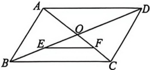

如图，$\square ABCD$ 的对角线 $AC$，$BD$ 相交于点 $O$，$E$，$F$ 分别是 $OB$，$OC$ 的中点. 若 $BC=14$, $AC=12$, $BD=20$, 则 $\triangle OEF$ 的周长为

A. 11.5

B. 15

C. 22

D. 23

> [!question]- 点击查看答案与解析
> 【答案】B
> 
> 【考点】平行四边形的性质、三角形中位线 → [[【初中数学知识点体系-人教版】#21-1 平行四边形]]
> 
> 【解析】
> 四边形 $ABCD$ 是平行四边形，
> $\because$ 对角线互相平分，$\therefore OA=OC$，$OB=OD$。
> $\because AC=12$，$\therefore OC=6$；$\because BD=20$，$\therefore OB=10$。
> $\because E$、$F$ 分别是 $OB$、$OC$ 的中点，
> $\therefore OE=\frac{1}{2}OB=5$，$OF=\frac{1}{2}OC=3$。
> $\because E$、$F$ 分别是 $OB$、$OC$ 的中点，
> $\therefore EF$ 是 $\triangle OBC$ 的中位线，
> $\therefore EF=\frac{1}{2}BC=\frac{1}{2}\times14=7$。
> $\therefore \triangle OEF$ 的周长 $=OE+OF+EF=5+3+7=15$，选 B。
> 
> 【易错点】平行四边形对角线互相平分，中点坐标公式的运用
