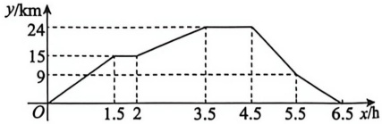

小明从家出发骑车去郊游，途中依次在 A，B 两个景点各停留了一段时间，然后沿原路骑行回到家。小明离家的距离 $y$（单位：km）与时间 $x$（单位：h）之间的关系如图所示，下列说法中正确的是

A. 小明在 A 景点停留了 1 h

B. 小明从 B 景点回到家骑行了 1 h

C. 当 $x=1$ 时，小明离家的距离为 10 km

D. 当 $2 \leq x \leq 5.5$ 时，小明离家的距离的取值范围是 $9 \leq y \leq 15$

> [!question]- 点击查看答案与解析
> 【答案】C
> 
> 【考点】一次函数的实际应用（图象分析） → [[【初中数学知识点体系-人教版】#23-2 一次函数的应用]]
> 
> 【解析】
> 从函数图象读取关键点：$(0,0)$、$(1.5,15)$、$(2,15)$、$(3.5,24)$、$(4.5,24)$、$(5.5,9)$、$(6.5,0)$。
> - A. 小明在 A 景点停留时间 $=2-1.5=0.5$ h，选项说 $1$ h，**错误**；
> - B. 小明从 B 景点回到家骑行时间 $=6.5-4.5=2$ h，选项说 $1$ h，**错误**；
> - C. 第一段图象过 $(0,0)$ 和 $(1.5,15)$，斜率为 $\frac{15}{1.5}=10$，即 $y=10x$。当 $x=1$ 时，$y=10\times1=10$ km，**正确**；
> - D. 当 $2 \leq x \leq 5.5$ 时，$y$ 的最大值为 $24$（$x\in[3.5,4.5]$ 时），最小值为 $9$（$x=5.5$ 时），取值范围应为 $9 \leq y \leq 24$，选项说 $9 \leq y \leq 15$，**错误**。
> 
> 因此选 C。
> 
> 【易错点】读懂函数图象中横轴和纵轴的含义，注意停留时间对应水平线段的长度，取值范围要找到区间内的最大值和最小值
