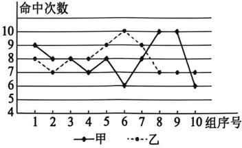

甲、乙两名运动员进行罚球线上投篮测试，每人投篮10组，每组投篮10次. 这两名运动员每组投篮命中次数的数据如图所示. 有下列结论：

$①$ 甲的前5个数据的离散程度比后5个数据的离散程度小；

$②$ 乙的前5个数据的离散程度比后5个数据的离散程度大；

$③$ 甲的10个数据的离散程度比乙的10个数据的离散程度大.

其中所有正确结论的序号是

A. $①$

B. $②$

C. $①③$

D. $②③$

> [!question]- 点击查看答案与解析
> 【答案】C
> 
> 【考点】数据的波动（离散程度） → [[【初中数学知识点体系-人教版】#24-2 数据的波动]]
> 
> 【解析】
> 从折线图读取数据：
> 甲的10个数据：$8, 8, 7, 7, 6, 10, 9, 10, 10, 6$；
> 乙的10个数据：$8, 7, 8, 7, 8, 10, 9, 7, 7, 7$。
> 
> 甲的前5个数据 $8, 8, 7, 7, 6$，平均数 $\bar{x}=7.2$，方差 $s^2=\frac{0.64+0.64+0.04+0.04+1.44}{5}=0.56$；
> 甲的后5个数据 $10, 9, 10, 10, 6$，平均数 $\bar{x}=9$，方差 $s^2=\frac{1+0+1+1+9}{5}=2.4$。
> 甲的前5个数据离散程度比后5个小，$\text{①}$ **正确**。
> 
> 乙的前5个数据 $8, 7, 8, 7, 8$，平均数 $\bar{x}=7.6$，方差 $s^2=\frac{0.16+0.36+0.16+0.36+0.16}{5}=0.24$；
> 乙的后5个数据 $10, 9, 7, 7, 7$，平均数 $\bar{x}=8$，方差 $s^2=\frac{4+1+1+1+1}{5}=1.6$。
> 乙的前5个数据离散程度比后5个小，$\text{②}$ **错误**。
> 
> 甲的10个数据方差约为 $2.29$，乙的10个数据方差约为 $0.96$，甲的离散程度比乙大，$\text{③}$ **正确**。
> 
> 因此 $\text{①③}$ 正确，选 C。
> 
> 【易错点】离散程度（方差）越大，数据波动越大；离散程度越小，数据越稳定。需通过具体计算方差来判断，不能仅凭直观感觉
