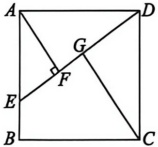

如图，在正方形 $ABCD$ 中，点 $E$ 在边 $AB$ 上，$AF \perp DE$，垂足为 $F$，$CG \parallel AF$ 交 $DE$ 于点 $G$。若 $FG=1$，$\triangle CDG$ 的面积为 4，则正方形 $ABCD$ 的边长为

A. 5

B. $\sqrt{13}$

C. $\sqrt{15}$

D. $\sqrt{17}$

> [!question]- 点击查看答案与解析
> 【答案】D
> 
> 【考点】正方形的性质、全等三角形、勾股定理 → [[【初中数学知识点体系-人教版】#21-2 特殊的平行四边形]]
> 
> 【解析】
> 设正方形 $ABCD$ 边长为 $a$，
> $\because AF \perp DE$，$CG \parallel AF$，$\therefore CG \perp DE$。
> 可证 $\triangle ADE \cong \triangle DCG$（AAS 或 ASA），
> $\therefore AE=DG$，$DE=CG$。
> 在 $\triangle CDG$ 中，$\angle CDG+\angle ADE=90^\circ$，$\angle DAE+\angle ADE=90^\circ$，
> $\therefore \angle CDG=\angle DAE$，
> 又 $\because \angle CGD=\angle AED=90^\circ$，$AD=DC$，
> $\therefore \triangle ADE \cong \triangle DCG$。
> 
> $\because FG=1$，设 $DG=x$，则 $AE=x$，$DE=CG=x+1$。
> $\triangle CDG$ 的面积 $=\frac{1}{2}\times DG \times CG = \frac{1}{2}x(x+1)=4$，
> 解得 $x^2+x-8=0$，$x=\frac{-1+\sqrt{33}}{2}$（舍负）。
> 
> 由勾股定理：$a^2=AD^2=AE^2+DE^2=x^2+(x+1)^2=2x^2+2x+1$。
> 代入 $x^2+x=8$，得 $a^2=2\times8+1=17$，
> $\therefore a=\sqrt{17}$，选 D。
> 
> 【易错点】正方形中注意利用全等三角形和勾股定理建立方程求解
