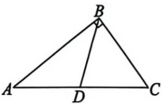

如图，在 Rt△ABC 中，∠ABC=90°，D 是 AC 的中点. 若 $AB=8$，$BD=5$，则 BC 的长为 ___ .

> [!question]- 点击查看答案与解析
> 【答案】6
> 
> 【考点】直角三角形斜边中线性质、勾股定理 → [[【初中数学知识点体系-人教版】#20-1 勾股定理]]
> 
> 【解析】
> Rt$\triangle ABC$ 中，$\angle ABC=90^\circ$，$D$ 是 $AC$ 的中点，
> $\because$ 直角三角形斜边上的中线等于斜边的一半，
> $\therefore BD=\frac{1}{2}AC$，即 $AC=2BD=10$。
> 由勾股定理：$BC^2=AC^2-AB^2=10^2-8^2=100-64=36$，
> $\therefore BC=6$（舍负）。
> 
> 【易错点】直角三角形斜边中线等于斜边的一半，注意与等腰三角形中线区分
